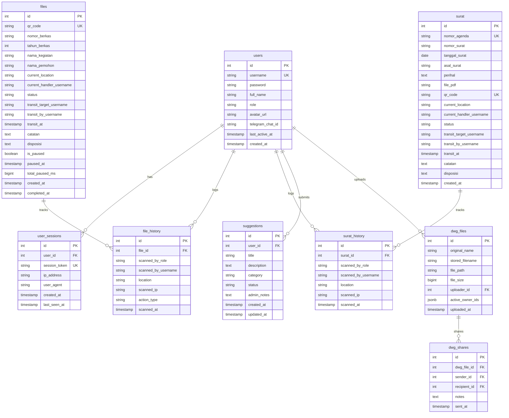
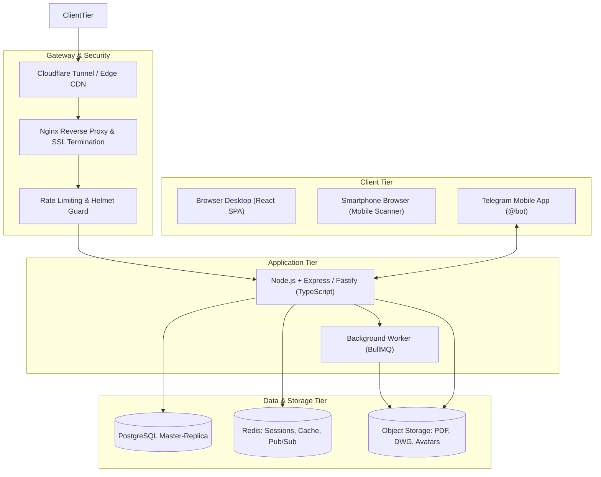

# 🏛️ Dokumen Handover & Blueprint Komprehensif: Pantau Kantah Tangsel

Dokumen ini berisi rangkuman menyeluruh konteks bisnis, tata kelola alur kerja SOP, spesifikasi fitur lengkap, skema relasi data, serta rancangan arsitektur enterprise dari aplikasi **Pantau.Kantah Tangsel** *(berevolusi dari Pantau.SP Tangsel)*.

Dokumen ini dirancang khusus sebagai **Handover Guide & System Blueprint** agar dapat langsung diberikan kepada arsitek perangkat lunak, tim pengembang, maupun asisten AI di awal percakapan (*prompt*) untuk melanjutkan pembangunan, skalabilitas, atau migrasi sistem skala besar tanpa kehilangan detail kontekstual historis.

---

## 1. Konteks Bisnis & Domain Knowledge

Aplikasi ini bertugas memantau pergerakan fisik dokumen permohonan pertanahan dan administrasi persuratan secara *real-time* berbasis **QR Code** di lingkungan **Kantor Pertanahan (Kantah) ATR/BPN Kota Tangerang Selatan**.

### 1.1. Evolusi Sistem
1. **Fase 1 (Pantau.SP Tangsel):** Terfokus eksklusif pada pelacakan berkas pelayanan teknis pada Seksi Survei dan Pemetaan (Seksi SP).
2. **Fase 2 (Pantau Kantah Tangsel - Status Saat Ini):** Memperluas cakupan layanan ke Seksi Penetapan Hak dan Pendaftaran (Seksi PHP), Administrasi Persuratan Terpadu (Surat Masuk & Arsip Digital PDF), Pertukaran Berkas Gambar Kadastral (AutoCAD `.dwg`), Live Web-App Monitoring, serta integrasi Bot Telegram Resmi.
3. **Fase 3 (Target Enterprise Kantah):** Integrasi menyeluruh lintas seluruh seksi di Kantor Pertanahan, arsitektur microservices/modular TypeScript, migrasi ke PostgreSQL, Redis Caching, dan integrasi API Kementerian ATR/BPN.

---

## 2. Alur Pelayanan Berkas & Klasifikasi 14 Kegiatan

Permohonan berkas diklasifikasikan ke dalam **14 Jenis Kegiatan Layanan**, terbagi dalam dua kelompok alur kerja (*Workflow Groups*):

### A. Kelompok 1 (Alur Seksi Survei dan Pemetaan - 5 Kegiatan)
1. **Pengukuran dan Pemetaan Kadastral** (SOP: 12 Hari Kerja)
2. **Pemecahan / Penggabungan / Pemisahan Bidang** (SOP: 15 Hari Kerja)
3. **Penataan Batas** (SOP: 20 Hari Kerja)
4. **Pendaftaran Tanah Pertama Kali (Pengakuan / Penegasan Hak)** (SOP: 98 Hari Kerja)
5. **Wakaf / Pemberian Hak BMN** (SOP: 5 Hari Kerja)

*Urutan Alur Standar Seksi SP:*
`Petugas Entry Berkas` &rarr; `Koordinator Kelompok Substansi Pengukuran` &rarr; `Petugas Ukur` &rarr; `Asisten Surveyor Kadastral` &rarr; `Petugas Pemetaan` &rarr; `Petugas Alih Media` &rarr; `Petugas Penyelesaian Berkas` &rarr; `Petugas Distribusi Berkas Ke Seksi PHP` / `Selesai`.

### B. Kelompok 2 (Alur Seksi Penetapan Hak dan Pendaftaran - 9 Kegiatan)
1. **Pelepasan Sebagian Hak** (SOP: 38 Hari Kerja)
2. **Pemberian Hak Milik Perseorangan** (SOP: 38 Hari Kerja)
3. **Pemberian Hak Guna Bangunan / Hak Pakai Badan Hukum** (SOP: 38 Hari Kerja)
4. **Permohonan Surat Keputusan (SK) Hak** (SOP: 38 Hari Kerja)
5. **Sertipikat Pengganti Karena Rusak / Blangko Lama** (SOP: 19 Hari Kerja)
6. **Sertipikat Pengganti Karena Hilang** (SOP: 40 Hari Kerja)
7. **Pendaftaran Hak Berdasarkan Lelang Eksekusi** (SOP: 40 Hari Kerja)
8. **Penegasan Tanah Wakaf dari Tanah Bersertipikat** (SOP: 5 Hari Kerja)
9. **Penegasan Tanah Wakaf Belum Terdaftar** (SOP: 98 Hari Kerja)

*Urutan Alur Standar Seksi PHP:*
`Petugas Entry Berkas PHP` &rarr; `Petugas Seksi PHP` &rarr; `Petugas Loket Penyerahan Produk` &rarr; `Selesai`.

---

## 3. Logika Inti & Tata Kelola Sistem (Core Business Rules)

### 3.1. Mesin Penghitung Hari Kerja SLA (Service Level Agreement)
- **Aturan Hari Kerja:** Penghitungan SLA berkas hanya menghitung **Hari Kerja Efektif** (Senin s.d. Jumat). Hari Sabtu dan Minggu sepenuhnya diabaikan.
- **Kalender Libur Nasional:** Sistem mengintegrasikan daftar resmi **Hari Libur Nasional & Cuti Bersama (SKB 3 Menteri)** (`INDONESIAN_HOLIDAYS`). Libur resmi tidak mengurangi kuota hari SLA.
- **Peringatan Stagnasi Meja (*Stalled Alert*):**
  - Mengendap $\ge 2$ hari kerja di meja yang sama: Indikator Kuning.
  - Mengendap $\ge 3$ hari kerja di meja yang sama: Indikator Peringatan Merah (*Stalled Alert*).
- **Fitur Pause & Resume SLA (Khusus Administrator):**
  - Jika pemohon belum melunasi Surat Perintah Setor (SPS) atau berkas menunggu kelengkapan eksternal, Administrator dapat menghentikan sementara perhitungan SLA (*Pause*).
  - Saat diaktifkan kembali (*Resume*), selisih durasi jeda (`total_paused_ms`) dikompensasikan ke target jatuh tempo (*due date*).

### 3.2. Tata Kelola Alur Pengiriman Terarah (*Strict Transit*)
- Berkas **TIDAK BISA** langsung dipindai (*scan*) oleh sembarang petugas sebelum pemegang berkas sebelumnya menekan tombol **Kirim Berkas (Transit)** dan memilih **Nama Petugas Tujuan**.
- Selama masa transit, status berkas berubah menjadi `Dalam Transit`.
- **Batal Kirim:** Pengirim berkas atau Administrator memiliki hak untuk membatalkan status transit jika salah memilih nama petugas tujuan.
- **Serah Terima:** Petugas penerima melakukan pemindaian (*Scan*) atau menekan tombol **Scan Terima** pada lonceng notifikasi untuk memindahkan kepemilikan berkas ke mejanya.
- **Oper Sesama Jabatan (*Peer Handover*):** Berkas dapat dipindahkan ke petugas dengan peran (*role*) yang sama (misal: sesama Petugas Entry atau sesama Petugas Ukur) asalkan `username` berbeda.

### 3.3. Multi-Role & Konfirmasi Pintar (*Smart Role Selection*)
- Satu pengguna dapat memegang beberapa peran sekaligus (contoh: seorang ASN menjabat sebagai `Petugas Ukur` sekaligus `Petugas Pemetaan`).
- Ketika melakukan pemindaian berkas, sistem cerdas menganalisis riwayat berkas sebelumnya dan secara otomatis menyarankan peran yang paling relevan untuk aksi saat itu, dengan opsi pemilihan peran manual jika diperlukan.

---

## 4. Fitur-Fitur Unggulan Sistem Saat Ini

### 4.1. Lonceng Notifikasi & Audio Chime Lokal (`NotificationBell.jsx`)
- Polling otomatis setiap 20 detik ke endpoint transit.
- **Web Audio API Chime (~3,2 Detik):** Menggunakan synthesizer osilator ganda bawaan browser untuk menghasilkan nada pengumuman jernih tanpa memerlukan file audio eksternal dan 100% bekerja di jaringan intranet/offline.
- Notifikasi bersuara aktif saat pertama kali login jika ada berkas yang menunggu di meja, maupun saat kiriman berkas baru tiba.

### 4.2. Integrasi Bot Telegram Resmi (`@pantaukantahtangsel_bot`)
- **Pendaftaran Mandiri Terverifikasi Kata Sandi:** Staf mendaftarkan akun melalui chat Telegram dengan format `/daftar <username> <password>`. Verifikasi kata sandi menjamin Chat ID tidak bisa dibajak oleh pihak yang tidak berhak.
- **Perintah Interaktif:** `/start` (panduan), `/daftar` (otentikasi), `/status` atau `/cek` (melihat berkas transit aktif), `/stop` atau `/putus` (memutuskan integrasi).
- **Notifikasi Push Real-Time:** Notifikasi dikirim instan ke smartphone petugas saat berkas dikirim kepadanya, saat status transit dibatalkan, saat ada berkas DWG masuk, atau saat staf mengirimkan saran baru ke Admin.

### 4.3. Modul Monitoring Persuratan & Digitalisasi Arsip PDF
- **Penomoran Agenda 5 Digit Otomatis:** Setiap surat masuk mendapatkan nomor agenda urut (`00001`, `00002`, dst.).
- **Cetak Slip QR Standar:** Dilengkapi nomor agenda, asal surat, perihal, dan alamat IP petugas entri.
- **Manajemen Berkas Fisik PDF:** Pengunggahan dokumen surat format PDF (hingga 15 MB) yang dapat dipratinjau langsung di dalam aplikasi.
- **Pelacakan Perjalanan Surat:** Fitur transit, riwayat pemindaian (`surat_history`), disposisi pimpinan, dan catatan surat.

### 4.4. Ruang Berkas DWG (AutoCAD) Bilateral
- **Hak Akses Terisolasi:** Eksklusif untuk peran `Asisten Surveyor Kadastral` (ASK), `Petugas Pemetaan`, dan `Administrator`.
- **Pertukaran File Kadastral:** Upload dan sharing berkas `.dwg` hingga 100 MB. Mendukung pengiriman langsung maupun meneruskan (*forward*) file dari folder pribadi.
- **Penyimpanan Berkas Cerdas (Multi-Owner Reference):** Berkas fisik di server menggunakan penghitungan referensi; file fisik hanya dihapus dari storage disk apabila semua pihak (pengirim dan penerima) telah menghapus referensi file tersebut dari daftar mereka.
- **Integrasi Telegram:** Notifikasi instan beserta catatan kendala langsung dikirim ke Telegram penerima saat file DWG ditransfer.

### 4.5. Kotak Saran & Ide Komunitas (Feedback Hub)
- Floating button interaktif di pojok kanan bawah Home Hub.
- Pengguna dapat mengirimkan usulan perbaikan fitur, peningkatan alur kerja, atau laporan kendala.
- Notifikasi instan dikirim ke seluruh Administrator via Telegram.
- Pengguna dapat memantau progres saran (*Menunggu Review*, *Ditinjau*, *Diterima*, *Selesai*, *Ditolak*) serta membaca catatan feedback dari tim admin.

### 4.6. Web-App Stats & Live User Tracking
- Pemantauan pengguna online secara langsung (toleransi aktivitas 5 menit terakhir).
- Menampilkan IP Address terakhir, sesi perangkat aktif, dan status koneksi Telegram.
- Administrator memiliki kewenangan memutus paksa (*Kick Session*) akun yang mencurigakan.
- Limitasi sesi maksimal 2 perangkat (*concurrent devices*) per akun pengguna.

### 4.7. Admin Dashboard & Ekspor Laporan Excel 2-Sheet
- Filter multi-dimensi: Bulan/Tahun Masuk, Rentang Tanggal Spesifik, Jenis Kegiatan, Status Berkas, dan Status Kepatuhan SLA.
- Ekspor Microsoft Excel (`.xlsx`) otomatis ke dalam 2 lembar kerja:
  - **Sheet 1 (Daftar Berkas):** Rincian lengkap seluruh berkas hasil filter.
  - **Sheet 2 (Rekap Bulanan Kegiatan):** Matriks agregasi per jenis kegiatan mencakup total berkas, sedang proses, selesai, ditutup, aman SLA, terlambat SLA, dan persentase kepatuhan.

---

## 5. Daftar Peran (Roles) & Matriks Hak Akses

Sistem memiliki **14 Peran Spesifik** yang dapat digabungkan (*multi-role comma-separated*):

| No | Nama Peran (*Role Name*) | Modul Utama | Hak Akses Utama |
|---|---|---|---|
| 1 | `Administrator` | Seluruh Modul | Hak penuh: CRUD Pengguna, Stats, Force Complete, Close, Pause SLA, Kick Sesi, Review Saran |
| 2 | `Kepala Seksi Survei dan Pemetaan` | Berkas & Surat | Monitoring menyeluruh, Disposisi Pimpinan, Analitik KPI |
| 3 | `Koordinator Kelompok Substansi Pengukuran` | Berkas & Surat | Monitoring alur teknis SP, Disposisi Pimpinan, Distribusi tugas ukur |
| 4 | `Petugas Entry Surat` | Surat Masuk | Registrasi surat, penomoran agenda, upload PDF, cetak slip QR agenda |
| 5 | `Petugas Entry Berkas` | Berkas SP (K1) | Entri berkas permohonan Kelompok 1, cetak slip QR berkas |
| 6 | `Petugas Entry Berkas PHP` | Berkas PHP (K2) | Entri berkas permohonan Kelompok 2, cetak slip QR berkas |
| 7 | `Petugas Ukur` | Berkas SP (K1) | Pelaksanaan pengukuran lapangan, penerimaan transit berkas |
| 8 | `Asisten Surveyor Kadastral` | Berkas & DWG | Pengolahan data spasial, kirim/terima file DWG ke Petugas Pemetaan |
| 9 | `Petugas Pemetaan` | Berkas & DWG | Validasi bidang peta, kirim/terima file DWG dari ASK, cetak peta bidang |
| 10 | `Petugas Alih Media` | Berkas SP (K1) | Digitalisasi warkah dan pemindaian dokumen fisik berkas |
| 11 | `Petugas Penyelesaian Berkas` | Berkas SP (K1) | Penyelesaian akhir berkas teknis SP |
| 12 | `Petugas Distribusi Berkas Ke Seksi PHP` | Berkas SP (K1) | Jembatan pengiriman fisik berkas dari Seksi SP ke Seksi PHP |
| 13 | `Petugas Seksi PHP` | Berkas PHP (K2) | Pemrosesan hak, pembukuan hak, dan pencatatan buku tanah |
| 14 | `Petugas Loket Penyerahan Produk` | Berkas PHP (K2) | Penyerahan produk sertipikat kepada pemohon, penutupan status berkas selesai |

---

## 6. Spesifikasi Skema Database (Referensi Migrasi PostgreSQL)

Struktur tabel di bawah ini merefleksikan model operasional SQLite saat ini yang harus dipetakan ke dalam model relasional **PostgreSQL (menggunakan Prisma / Drizzle ORM)**:

### 6.1. Skema ERD Relasional



---

## 7. Rencana Arsitektur Enterprise-Grade (Pantau Kantah)

Untuk mendukung ratusan pengguna simultan di seluruh Kantor Pertanahan, arsitektur masa depan dirancang dengan standar enterprise:



### 7.1. Komponen Standar Enterprise
1. **Bahasa & Runtime:** TypeScript pada Node.js 20+ LTS (menghindari error `undefined` pada runtime dan memastikan tipe data kontrak ketat).
2. **Pola Desain (Clean Architecture / Modular MVC):**
   - `/src/modules/berkas` -> Domain logic berkas, router, controller, service, repository.
   - `/src/modules/surat` -> Domain persuratan dan arsip digital.
   - `/src/modules/dwg` -> File exchange and storage service.
   - `/src/modules/auth` -> JWT issuance, session management, password hashing.
   - `/src/middlewares` -> RBAC guard, input validation via `Zod`, rate limiter.
3. **Database & ORM:** PostgreSQL 16+ dengan Prisma ORM atau Drizzle ORM, didukung connection pooler (*PgBouncer*).
4. **Caching & Asinkron:** Redis untuk menyimpan status pengguna online (*heartbeat*), kuota rate limit, dan *queue worker* (BullMQ) untuk pengiriman notifikasi Telegram dan email.
5. **Storage Media:** Menggunakan S3-compatible Object Storage (seperti MinIO atau Cloudflare R2) menggantikan penyimpanan folder lokal (`uploads/`), agar kontainer backend bersifat *stateless*.

---

## 8. Panduan Deployment & Aturan Keamanan Server (QNAP & Cloudflare)

### 8.1. Konfigurasi Lingkungan (*Environment Variables*)
Variabel penting yang wajib dikonfigurasi pada `.env`:
```ini
NODE_ENV=production
PORT=3001
HTTPS_PORT=3002
JWT_SECRET=super_secret_jwt_key_pantau_kantah
TELEGRAM_BOT_TOKEN=7744317134:AAG... # Token bot Telegram resmi
BASE_APP_URL=https://pantaukantahtangsel.web.id
MAX_SESSIONS_PER_USER=2
MAX_FILE_SIZE_DWG_MB=100
MAX_FILE_SIZE_PDF_MB=15
```

### 8.2. Protokol Keamanan Server Produksi (QNAP NAS)
> [!CAUTION]
> **ATURAN KEAMANAN MUTLAK DATA PRODUKSI:**
> 1. **DILARANG KERAS** menjalankan `git reset --hard` atau `git clean` pada direktori server produksi (`\\10.2.0.122\Pantau SP Tangsel\file-tracker`).
> 2. **JANGAN PERNAH** menimpa, menghapus, atau merestart folder `backend/database.sqlite`, `backend/uploads/` (PDF surat, foto profil, dan file DWG), serta sertifikat SSL (`.pem`).
> 3. Selalu lakukan sinkronisasi kode dengan metode `fetch` + `reset --mixed origin/main` atau penyalinan selektif folder `frontend/dist/`.
> 4. Pastikan script backup berkala `auto_backup.sh` berjalan di cron QNAP setiap hari pada pukul 00:00 WIB dengan retensi cadangan 30 hari.

---

## 9. Instruksi Memulai Percakapan untuk Asisten AI Baru

Saat memulai thread atau proyek baru menggunakan blueprint ini, gunakan instruksi berikut:

> *"Halo AI, saya melampirkan file `HANDOVER_PANTAU_KANTAH.md`. Dokumen ini adalah rancangan arsitektur dan spesifikasi bisnis lengkap dari sistem aplikasi 'Pantau.Kantah Tangsel'. Tolong pelajari seluruh aturan bisnis (SLA hari kerja, alur 14 kegiatan, strict transit, telegram bot, dwg workspace, multi-role, dan skema database). Mulai saat ini, setiap kode, refaktor, skema database, atau fitur yang kita bangun harus tunduk dan selaras dengan standar blueprint ini."*
