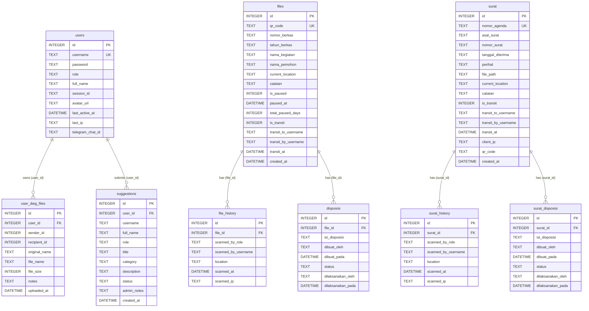

# 🏛️ Dokumen Handover & Blueprint Komprehensif: Pantau.Kantah Tangsel

Dokumen ini merupakan **Single Source of Truth (SSOT)**, panduan serah terima (*handover*), sekaligus cetak biru arsitektur (*system blueprint*) dari aplikasi **Pantau.Kantah Tangsel** — Portal Aplikasi Pelacakan Berkas & Persuratan Terpadu di **Kantor Pertanahan (Kantah) ATR/BPN Kota Tangerang Selatan**.

seluruh spesifikasi di dalam dokumen ini telah **diverifikasi 100% sesuai dengan implementasi kode aktual** pada *backend* (`backend/server.js`) dan *frontend* (`frontend/src/`). Berikan dokumen ini kepada pengembang atau asisten AI di awal sesi agar konteks sistem dapat dipahami secara utuh dan presisi tanpa perlu menjelaskan dari awal.

---

## 1. Konteks Bisnis & Evolusi Sistem

Aplikasi ini melacak pergerakan fisik berkas permohonan pelayanan pertanahan dan agenda surat masuk secara *real-time* menggunakan **QR Code berbasis JSON Web Token (JWT)**, dilengkapi pemantauan **Service Level Agreement (SLA / SOP)**, analitik **Key Performance Indicator (KPI)** pegawai, ruang kerja pertukaran file kadastral **AutoCAD (`.dwg`)**, serta peralatan manipulasi dokumen **PDF In-Browser**.

- **Fase 1 (`SILACAK` &rarr; `Pantau.SP Tangsel`):** Melacak berkas permohonan teknis pada Seksi Survei dan Pemetaan (Seksi SP).
- **Fase 2 (`Pantau.Kantah Tangsel` — Produksi Saat Ini):** Mencakup kolaborasi alur berkas antara Seksi Survei dan Pemetaan (Seksi SP / Kelompok 1) dan Seksi Penetapan Hak dan Pendaftaran (Seksi PHP / Kelompok 2), Modul Administrasi Persuratan & Arsip PDF, Dashboard KPI Seluruh Pegawai, Ruang Berkas DWG Bilateral, Kotak Saran Fitur, serta Pemantauan Pengguna Online (*Web-App Stats*).
- **Fase 3 (`Target Skalabilitas Enterprise`):** Refaktorisasi menuju arsitektur modular *TypeScript*, migrasi database dari SQLite ke *PostgreSQL*, manajemen sesi/antrean berbasis *Redis*, dan penyimpanan dokumen berbasis *Object Storage (S3/MinIO)*.

🌐 **Domain Produksi Resmi:** [https://pantaukantahtangsel.web.id](https://pantaukantahtangsel.web.id) *(Dijalankan di atas QNAP NAS Container Station + Cloudflare Tunnel).*

---

## 2. Katalog 14 Jenis Kegiatan Layanan & Target Hari Kerja SOP

Sistem mengelompokkan berkas permohonan ke dalam **14 Jenis Kegiatan** yang terbagi atas **Kelompok 1 (5 Kegiatan)** dan **Kelompok 2 (9 Kegiatan)**. Nama kegiatan di bawah ini bersifat **eksak (*case-sensitive*)** sebagaimana digunakan pada database, validasi API, dan kalkulator SLA (`frontend/src/utils/dateUtils.js`):

### 2.1. Kelompok 1 (`K1` — Dientri oleh `Petugas Entry Berkas` / `Administrator`)
| No | Nama Kegiatan (Eksak di Sistem) | Target SOP | Lokasi Awal Saat Entri |
| :-: | :--- | :-: | :--- |
| 1 | `Pengukuran dan Pemetaan Kadastral` | **12 Hari Kerja** | `Loket Pendaftaran (Entry)` |
| 2 | `Pemecahan Bidang` | **15 Hari Kerja** | `Loket Pendaftaran (Entry)` |
| 3 | `Penggabungan Bidang` | **15 Hari Kerja** | `Loket Pendaftaran (Entry)` |
| 4 | `Pemisahan Bidang` | **15 Hari Kerja** | `Loket Pendaftaran (Entry)` |
| 5 | `Penataan Batas` | **20 Hari Kerja** | `Loket Pendaftaran (Entry)` |

### 2.2. Kelompok 2 (`K2` — Dientri oleh `Petugas Entry Berkas PHP` / `Administrator`)
| No | Nama Kegiatan (Eksak di Sistem) | Target SOP | Lokasi Awal Saat Entri |
| :-: | :--- | :-: | :--- |
| 6 | `Pelepasan Sebagian Hak` | **38 Hari Kerja** | `Petugas Entry Berkas PHP` |
| 7 | `Wakaf dari Tanah Yang Sudah Bersertipikat` | **5 Hari Kerja** | `Petugas Entry Berkas PHP` |
| 8 | `Pendaftaran Tanah Pertama Kali Pemberian Hak` | **38 Hari Kerja** | `Petugas Entry Berkas PHP` |
| 9 | `Pendaftaran Tanah Pertama Kali Pengakuan/Penegasan Hak` | **98 Hari Kerja** | `Petugas Entry Berkas PHP` |
| 10 | `Pendaftaran Tanah Pertama Kali Pemberian Hak (BMN)` | **5 Hari Kerja** | `Petugas Entry Berkas PHP` |
| 11 | `Pendaftaran Tanah Pertama Kali Penegasan Tanah Wakaf` | **98 Hari Kerja** | `Petugas Entry Berkas PHP` |
| 12 | `Sertipikat Pengganti Karena Hilang/Lelang Eksekusi` | **40 Hari Kerja** | `Petugas Entry Berkas PHP` |
| 13 | `Sertipikat Pengganti Karena Rusak/Lama` | **19 Hari Kerja** | `Petugas Entry Berkas PHP` |
| 14 | `Permohonan SK` | **38 Hari Kerja** | `Petugas Entry Berkas PHP` |

---

## 3. Alur Tahapan Berkas (`FLOWS`) & Aturan Penyelesaian Khusus

### 3.1. Definisi Alur Standar (`FLOWS` di `backend/server.js`)
- **Alur `FLOWS.K1` (Kelompok 1):**
  1. `Loket Pendaftaran (Entry)`
  2. `Petugas Ukur`
  3. `Asisten Surveyor Kadastral`
  4. `Petugas Pemetaan`
  5. `Petugas Alih Media`
  6. `Koordinator Kelompok Substansi Pengukuran dan Pemetaan Kadastral`
  7. `Kepala Seksi Survei dan Pemetaan`
  8. `Petugas Penyelesaian Berkas`
  9. `Selesai`

- **Alur `FLOWS.K2` (Kelompok 2):**
  1. `Petugas Entry Berkas PHP`
  2. `Petugas Pemetaan`
  3. `Koordinator Kelompok Substansi Pengukuran dan Pemetaan Kadastral`
  4. `Kepala Seksi Survei dan Pemetaan`
  5. `Petugas Penyelesaian Berkas`
  6. `Selesai`

### 3.2. Logika Khusus Pemindaian & Penyelesaian Otomatis (`POST /api/files/scan`)
Ketika berkas dipindai (*scan*), backend menerapkan aturan bisnis spesifik berdasarkan peran aktif (`activeRole`) pemindai:
1. **`Petugas Entry Berkas`**:
   - Setiap kali peran ini memindai berkas, `current_location` diubah menjadi `'Loket Pendaftaran (Entry)'`.
   - Sistem menghitung berapa kali berkas pernah berada di `'Loket Pendaftaran (Entry)'` (`loket_entry_count`) untuk menandai berkas yang dikembalikan/revisi ke loket.
2. **`Petugas Penyelesaian Berkas`**:
   - Memvalidasi bahwa `nama_kegiatan` termasuk dalam daftar 14 kegiatan `K1` atau `K2`, lalu mengubah posisi menjadi `'Petugas Penyelesaian Berkas'`.
3. **`Petugas Loket Penyerahan Produk`**:
   - **Khusus kegiatan `Pengukuran dan Pemetaan Kadastral`:** Wajib berasal dari posisi `current_location === 'Petugas Penyelesaian Berkas'` (jika belum, scan ditolak). Saat dipindai, posisi berkas **otomatis berubah menjadi `'Selesai'`** dengan pesan: *"Berkas Telah Diserahkan ke Pemohon (Selesai)"*.
   - **Untuk kegiatan lainnya:** Posisi berkas berubah menjadi `'Petugas Loket Penyerahan Produk'`.
4. **`Petugas Seksi PHP`**:
   - **Khusus kegiatan `Pengukuran dan Pemetaan Kadastral`:** Pemindaian **ditolak** (*"Mekanisme ini tidak berlaku untuk kegiatan Pengukuran dan Pemetaan Kadastral"*).
   - **Untuk `Pemecahan Bidang`, `Penggabungan Bidang`, `Pemisahan Bidang`, dan `Penataan Batas`:**
     - Jika posisi sebelumnya adalah `'Petugas Penyelesaian Berkas'`, maka status berkas **otomatis berubah menjadi `'Selesai'`** dengan pesan: *"Berkas Telah Selesai di Seksi SP dan diserahkan ke Seksi PHP"*.
     - Jika berasal dari posisi lain, `current_location` menjadi `'Petugas Seksi PHP'`.
   - **Untuk 9 Kegiatan Kelompok 2 (`K2`):**
     - Jika posisi sebelumnya adalah `'Petugas Penyelesaian Berkas'`, maka status berkas **otomatis berubah menjadi `'Selesai'`** dengan pesan: *"Berkas Telah Selesai di Seksi PHP"*.
     - Jika berasal dari posisi lain, `current_location` menjadi `'Petugas Seksi PHP'`.
   - **Kondisi fallback lainnya:** Jika posisi sebelumnya adalah `'Petugas Distribusi Berkas Ke Seksi PHP'`, status berubah menjadi `'Selesai'` (*"Berkas Telah Selesai di Seksi SP"*).

---

## 4. Aturan Bisnis Inti (*Core Business Rules*)

### 4.1. Mesin Perhitungan Hari Kerja SOP/SLA & Pause/Resume
- **Perhitungan Hari Kerja (`getWorkingDays`):** Menghitung selisih hari dari `created_at` (UTC dari SQLite dikonversi via `parseSQLiteDate`) hingga hari ini (atau waktu selesai/ditutup), dengan **mengabaikan hari Sabtu (`6`), Minggu (`0`), serta daftar `INDONESIAN_HOLIDAYS`**.
- **Kalender Libur Nasional 2026 (`INDONESIAN_HOLIDAYS`):**
  Sinkron di backend dan frontend mencakup 16 tanggal merah & cuti bersama SKB 3 Menteri:
  `2026-01-01`, `2026-01-16`, `2026-02-17`, `2026-03-19`, `2026-03-20`, `2026-03-23`, `2026-03-24`, `2026-04-03`, `2026-05-01`, `2026-05-14`, `2026-05-27`, `2026-06-01`, `2026-06-16`, `2026-08-17`, `2026-08-25`, `2026-12-25`.
- **Mekanisme Pause & Resume SOP (Khusus `Administrator`):**
  - Saat di-*pause* (`POST /api/files/:qr_code/pause`), kolom `is_paused` diset menjadi `1` dan `paused_at` diisi waktu saat ini (`CURRENT_TIMESTAMP`).
  - **Kunci Pergerakan Saat Pause:** Berkas yang sedang berstatus `is_paused === 1` **ditolak untuk di-scan** dengan pesan: *"berkas tidak dapat dipindahkan karena belum membayar Surat Perintah Setor"*.
  - Saat dilanjutkan (`POST /api/files/:qr_code/resume`), sistem menghitung hari kerja selama masa pause (`getWorkingDays(file.paused_at, now)`) dan mengakumulasikannya ke kolom **`total_paused_days`** (satuan **hari kerja bulat**, bukan milidetik), lalu mereset `is_paused = 0` dan `paused_at = NULL`.
  - Umur efektif berkas (`calculateTotalElapsedDays`) dihitung dengan rumus:
    $$\text{Hari Efektif} = \max(0, \text{Total Hari Kerja} - (\text{total\_paused\_days} + \text{Hari Pause Berjalan}))$$
- **Indikator Warna & Stagnasi Meja (`getStatusColor` & `getStatusLabel`):**
  - `< 2` hari kerja (`0` atau `1` hari kerja di meja saat ini): **Hijau** (*"Aman: Berkas baru di meja ini"*).
  - `=== 2` hari kerja di meja saat ini: **Kuning** (*"Perhatian: Sudah 2 hari di meja ini"*).
  - `> 2` hari kerja ($\ge 3$ hari kerja di meja saat ini): **Merah** (*"Peringatan: Lebih dari 3 hari di meja ini"*).

### 4.2. Sistem *Strict Transit* & Serah Terima Berkas
- **Aturan Wajib Transit (`POST /api/files/scan`):**
  - Petugas biasa **tidak dapat memindai berkas** jika `file.is_transit !== 1` (ditolak dengan HTTP 403: *"Berkas ini belum dikirim (Transit) oleh petugas sebelumnya..."*).
  - Jika berkas sedang dalam status transit (`file.is_transit === 1`), **hanya petugas tujuan (`req.user.username === file.transit_to_username`)** yang diizinkan memindai berkas tersebut.
  - Pengecualian: Peran `Administrator` dapat melakukan *override* pemindaian kapan saja.
- **Pencatatan Histori Transit & Batal Transit:**
  - Saat berkas dikirim (`POST /api/files/:qr_code/transit`), sistem menyetel `is_transit = 1`, `transit_to_username`, `transit_by_username`, `transit_at = CURRENT_TIMESTAMP`, **serta menambahkan baris riwayat** di `file_history` dengan `location = "Dikirim (Transit) ke <Nama Tujuan>"`.
  - Saat dibatalkan (`POST /api/files/:qr_code/cancel-transit` — hanya oleh pengirim asli atau Administrator), sistem mereset kolom transit ke `0`/`NULL` dan mencatat baris di `file_history` dengan `location = "Batal Kirim (Transit ke <Nama Tujuan> dibatalkan)"`.
- **Oper Sesama Jabatan (*Peer Handover*):**
  - Jika lokasi baru hasil scan sama dengan `file.current_location` (jabatan sama), sistem memeriksa `scanned_by_username` terakhir di `file_history`.
  - Apabila `lastUsername !== req.user.username` (berbeda petugas), serah terima **diizinkan** (*"Berkas dipindahtangankan ke Anda di posisi <Role>"*). Jika petugasnya sama persis, scan ditolak (*"Posisi berkas sudah berada di <Nama>"*).

### 4.3. Multi-Role & *Smart Role Confirmation*
- Kolom `role` pada tabel `users` dapat menyimpan beberapa jabatan yang dipisahkan tanda koma (contoh: `"Petugas Ukur, Asisten Surveyor Kadastral"`).
- Saat pengguna multi-role memindai berkas tanpa menyertakan `selected_role`:
  - Backend mengecek histori pemindaian pengguna tersebut pada berkas terkait (`file_history`).
  - Jika pengguna sudah pernah memindai berkas itu dengan salah satu perannya dan masih memiliki peran lain yang belum digunakan pada berkas tersebut, backend mengembalikan respons `requires_smart_confirmation: true` beserta `suggested_role` (peran yang belum dipakai) dan `last_used_role`.
  - Jika belum pernah memindai berkas tersebut, backend mengembalikan `requires_role_selection: true` agar frontend menampilkan modal pilihan jabatan.

### 4.4. Perhitungan Analitik KPI Jam Kerja (`GET /api/reports/kpi` & `kpi-surat`)
- Menghitung durasi pemrosesan riil setiap petugas dalam satuan **Jam Kerja Efektif** dari satu scan ke scan berikutnya.
- **Penghentian Argometer Saat Transit:** Jika berkas berada pada tahap terakhir di meja petugas dan petugas tersebut telah menekan **Kirim Berkas (Transit)** (`is_transit === 1`), maka waktu akhir pemrosesan petugas tersebut dihentikan pada `transit_at` (bukan waktu sekarang), sehingga waktu tunggu kurir fisik tidak membebani KPI pengirim.
- **Pemotongan Jam Hari Libur (`holidayMs`):** Algoritma KPI melakukan iterasi harian antara `startTime` dan `endTime`, lalu memotong secara presisi irisan milidetik yang jatuh pada hari Sabtu, Minggu, maupun tanggal merah `INDONESIAN_HOLIDAYS`.

---

## 5. Spesifikasi Modul & Fitur Aplikasi

### 5.1. Portal Utama (`HomeHub.jsx`) & Sistem Tema Ganda (*Dual Theme*)
- **Mode Terang & Mode Gelap (*Light / Dark Glassmorphism*):** Dilengkapi saklar tema (*Segmented Theme Switcher*) di *Topbar* dan *Navbar* yang tersinkronisasi melalui `localStorage.getItem('theme')` (`light` sebagai default, atau `dark`) dan atribut `data-theme` pada `<html>`.
- **5 Kartu Modul Utama di Home Hub:**
  1. **Monitoring Berkas (`/berkas`):** Tabel pemantauan berkas layanan rutin PNBP, pencarian petugas (`CariBerkasPetugas`), Top 10 Petugas, filter status/kegiatan, entri berkas (`/entry`), dan pemindai QR (`/scan`).
  2. **Monitoring Surat (`/surat`):** Daftar agenda surat masuk, pratinjau/unduh PDF aman, cetak slip QR standar, entri surat (`/surat/entry`), detail perjalanan surat (`/surat/detail/:id`), dan pemindai QR agenda surat (`/surat/scan`).
  3. **Dashboard Kinerja (`/kpi`):** Dapat diakses oleh **seluruh pengguna yang login**. Memiliki 3 tab: **KPI Berkas**, **KPI Persuratan**, dan **Top 50 Berkas Aktif Terlama** (`Top50Berkas.jsx`).
  4. **PDF Tools Kantah (`/pdf-tools`):** Utilitas pengolahan dokumen PDF *100% client-side* di browser (tanpa membebani server) menggunakan `pdf-lib` & `pdfjs-dist`, meliputi: **Gabung PDF (Merge)**, **Pisah PDF (Split dengan pratinjau thumbnail halaman visual)**, **Kompresi Ukuran PDF**, **Putar Halaman (Rotate)**, dan **Konversi Gambar (JPG/PNG) ke PDF**.
  5. **Admin Panel & Pengguna (`/admin`):** Khusus `Administrator`. Mengintegrasikan manajemen berkas & surat, ekspor Excel 2-Sheet, kelola pengguna (`/admin/users`), dan pantauan statistik pengguna online (`/admin/stats`).

### 5.2. Lonceng Notifikasi Suara (`NotificationBell.jsx`) & Bot Telegram (`@pantaukantahtangsel_bot`)
- **Web Audio API Chime:** Membunyikan nada *harmonic chime* 2 putaran (~3,2 detik) secara *native* di browser tanpa file MP3/WAV eksternal, dengan *polling* tiap 20 detik ke `GET /api/notifications/transit`.
- **Bot Telegram Terintegrasi (`backend/server.js`):**
  - *Long-polling* setiap 5 detik ke Telegram Bot API (`getUpdates`).
  - Mendukung *deep-linking* `/start link_<username>` dan verifikasi wajib kata sandi `/daftar <username> <password>` (dicocokkan dengan hash `bcrypt` di database).
  - Perintah `/cek` atau `/status` untuk memeriksa jumlah berkas transit aktif, serta `/stop` atau `/putus` untuk melepas tautan.
  - Mengirimkan notifikasi otomatis pada 4 peristiwa: **(1) Berkas Masuk (Transit)**, **(2) Pembatalan Transit**, **(3) Kiriman File AutoCAD DWG Masuk**, dan **(4) Saran Fitur Baru Masuk (khusus ke Telegram Admin)**.

### 5.3. Profil Pengguna & Ruang Kerja DWG Antar-Petugas Teknis (`Profile.jsx`)
- **Profil & Avatar:** Pengguna dapat mengunggah/menghapus foto profil (`POST / DELETE /api/user/profile/avatar`, JPG/JPEG/PNG/WEBP maks 5 MB). Nama lengkap ditampilkan *read-only* di halaman profil pengguna untuk menjaga integritas nama pada histori.
- **Ruang Pertukaran Berkas DWG (AutoCAD):**
  - **Pembatasan Role Ketat (`requireDwgAccess`):** Dapat diakses oleh `Petugas Ukur`, `Asisten Surveyor Kadastral`, `Petugas Pemetaan`, dan `Administrator`.
  - **Pertukaran Berkas Multi-Arah (`GET /api/user/dwg/recipients`):**
    - `Petugas Ukur`, `Asisten Surveyor Kadastral`, dan `Petugas Pemetaan` dapat saling mengirim dan meneruskan berkas DWG hasil pengukuran dan pemetaan (serta ke `Administrator`).
    - `Administrator` dapat mengirim berkas DWG ke seluruh petugas teknis (`Petugas Ukur`, `ASK`, `Pemetaan`).
  - **Mekanisme Multi-Record & Referensi File Fisik:**
    - Saat file DWG (maks 100 MB) dikirim atau diteruskan (*forward*), sistem menyimpan **1 file fisik** di `backend/uploads/dwg/` dan membuat **2 baris record** di tabel `user_dwg_files` (1 baris dengan `user_id = recipientId` sebagai *Inbox* penerima, dan 1 baris dengan `user_id = senderId` sebagai *Outbox* pengirim).
    - Saat pengguna menghapus berkas DWG dari daftarnya, sistem menghapus baris milik `user_id` tersebut lalu mengecek `SELECT COUNT(*) FROM user_dwg_files WHERE file_name = ?`. File fisik `.dwg` di disk **hanya dihapus jika `count === 0`**.

### 5.4. Kotak Saran & Ide Fitur (`SuggestionModal.jsx`)
- Diakses melalui tombol *floating pill* di pojok kanan bawah Home Hub (di atas fixed footer).
- Kategori saran: `Fitur Baru`, `Peningkatan Alur / SOP`, `Tampilan / UI & UX`, `Performa & Kecepatan`, `Integrasi / Otomasi`, `Lainnya`.
- Pengguna biasa hanya melihat daftar saran miliknya sendiri, sedangkan `Administrator` melihat seluruh saran, dapat mengubah status (`Menunggu Review`, `Ditinjau`, `Diterima`, `Selesai`, `Ditolak`), serta menulis tanggapan resmi (`admin_notes`).

### 5.5. Web-App Stats & Manajemen Sesi (`WebAppStats.jsx`)
- **Tracking Aktivitas Real-Time (`authenticateJWT`):** Setiap request API yang terotentikasi memperbarui kolom `last_active_at = CURRENT_TIMESTAMP` dan `last_ip` pada tabel `users` dengan *in-memory throttling* (`userLastActiveMap`, maksimal 1 kali update DB per 30 detik per user agar tidak membebani SQLite).
- **Status Online:** Pengguna dihitung **Online** apabila `last_active_at >= datetime('now', '-5 minutes')`. Saat pengguna menekan tombol **Keluar** (`POST /api/logout`), `last_active_at` langsung dimundurkan 10 menit agar seketika berstatus **Offline**.
- **Batas Maksimal 2 Perangkat (`session_id`):** Kolom `session_id` menyimpan maksimal 2 token sesi heksadesimal yang dipisahkan koma (`s1,s2`). Login ke-3 otomatis menggeser (`shift()`) sesi paling lama.
- **Fitur Kick Sesi (`POST /api/admin/users/:id/kick`):** Administrator dapat mengosongkan `session_id = NULL` milik pengguna tertentu sehingga seluruh perangkat pengguna tersebut langsung terputus pada request berikutnya.

---

## 6. Daftar 14 Peran (*Roles*) Resmi dalam Sistem

Berikut adalah ke-14 nama peran eksak sebagaimana terdaftar pada `AVAILABLE_ROLES` di `UserManagement.jsx`:

| No | Nama Peran Eksak (`role`) | Wewenang & Tanggung Jawab Utama |
| :-: | :--- | :--- |
| 1 | `Administrator` | Akses penuh seluruh modul, CRUD user & multi-role, Force Complete, Close berkas/surat, Pause/Resume SLA, Kick sesi online, Review kotak saran, akses penuh DWG. |
| 2 | `Kepala Seksi Survei dan Pemetaan` | Monitoring berkas & surat, memberikan Disposisi Pimpinan pada berkas & surat, akses laporan analitik (`/api/reports/*`), bagian dari alur `FLOWS.K1` & `K2`. |
| 3 | `Koordinator Kelompok Substansi Pengukuran dan Pemetaan Kadastral` | Monitoring berkas & surat, memberikan Disposisi Pimpinan, bagian dari alur pemeriksaan `FLOWS.K1` & `K2`. |
| 4 | `Petugas Entry Surat` | Mendaftarkan surat masuk baru (`/surat/entry`), unggah PDF surat, cetak slip QR agenda 5 digit, mengirim transit surat. |
| 5 | `Petugas Entry Berkas` | Mendaftarkan berkas baru **Kelompok 1** (5 kegiatan SP), cetak slip QR berkas, lokasi awal otomatis tercatat sebagai `Loket Pendaftaran (Entry)`. |
| 6 | `Petugas Entry Berkas PHP` | Mendaftarkan berkas baru **Kelompok 2** (9 kegiatan PHP), cetak slip QR berkas, lokasi awal tercatat sebagai `Petugas Entry Berkas PHP`. |
| 7 | `Petugas Ukur` | Menerima kiriman transit berkas pengukuran (`K1`), memproses pengukuran lapangan, serta memiliki akses **Ruang Berkas DWG** untuk menyimpan dan saling bertukar file `.dwg` dengan ASK dan Petugas Pemetaan. |
| 8 | `Asisten Surveyor Kadastral` | Memproses berkas pengukuran/pemetaan (`K1`) serta memiliki akses khusus **Ruang Berkas DWG** untuk mengirim/menerima file `.dwg` dengan `Petugas Pemetaan` dan `Petugas Ukur`. |
| 9 | `Petugas Pemetaan` | Memetakan bidang tanah pada alur `K1` maupun `K2`, serta memiliki akses khusus **Ruang Berkas DWG** untuk bertukar file `.dwg` dengan `Asisten Surveyor Kadastral` dan `Petugas Ukur`. |
| 10 | `Petugas Alih Media` | Memproses digitalisasi/alih media warkah pada alur `FLOWS.K1`. |
| 11 | `Petugas Penyelesaian Berkas` | Memproses tahap penyelesaian akhir berkas pada alur `FLOWS.K1` dan `FLOWS.K2`. |
| 12 | `Petugas Distribusi Berkas Ke Seksi PHP` | Menjembatani penyerahan fisik berkas dari Seksi SP menuju Seksi PHP. |
| 13 | `Petugas Seksi PHP` | Menerima berkas di Seksi PHP; jika memindai berkas dari posisi `Petugas Penyelesaian Berkas` (untuk kegiatan pemecahan/penggabungan/pemisahan/penataan batas atau `K2`) maupun dari `Petugas Distribusi Berkas Ke Seksi PHP`, berkas otomatis berstatus `Selesai`. |
| 14 | `Petugas Loket Penyerahan Produk` | Menyerahkan produk akhir kepada pemohon; khusus kegiatan `Pengukuran dan Pemetaan Kadastral` yang berasal dari `Petugas Penyelesaian Berkas`, pemindaian langsung mengubah status berkas menjadi `Selesai`. |

---

## 7. Skema Database Aktual (SQLite) & Referensi Migrasi PostgreSQL

Sistem saat ini memiliki **9 Tabel Utama** di SQLite (`backend/database.sqlite`). Berikut adalah struktur kolom aktual beserta diagram relasinya:

### Catatan Penting Skema & Integritas Data:
1. **Cascade Update Username:** Apabila Administrator mengubah `username` seorang petugas melalui `PUT /api/users/:id`, sistem secara otomatis meng-update seluruh baris `scanned_by_username` di `file_history` agar metrik KPI historis petugas tersebut tidak terputus.
2. **Format `scanned_by_role`:** Disimpan dengan pola `"Nama Lengkap (Jabatan)"` (contoh: `"Budi Pengukur (Petugas Ukur)"`). Saat server dinyalakan, terdapat kueri *auto-repair* yang melengkapi `full_name` pada histori lama jika sebelumnya hanya tercatat nama jabatan.
3. **Proteksi Dokumen (`uploads/`):** Direktori `backend/uploads/` **tidak diekspos** melalui `express.static`.
   - File PDF surat hanya dapat diakses melalui `GET /api/surat/file/:filename` dengan verifikasi token JWT.
   - File AutoCAD DWG hanya dapat diunduh melalui `GET /api/user/dwg/:id/download` dengan verifikasi kepemilikan baris (`user_id = req.user.id`) dan middleware `requireDwgAccess`.
   - Foto avatar diakses melalui `GET /api/user/avatar/:filename` dengan sanitasi `path.basename()` anti-*path traversal*.

---

## 8. Daftar Lengkap Endpoint REST API (`backend/server.js`)

| Grup Modul | Method & Path | Middleware / Akses | Deskripsi Fungsi |
| :--- | :--- | :--- | :--- |
| **Auth & Sesi** | `GET /api/my-ip` | Publik | Mengambil alamat IP klien (`cf-connecting-ip` / `x-forwarded-for`). |
| | `POST /api/login` | `loginLimiter` | Otentikasi user, rotasi maks 2 sesi (`session_id`), terbitkan JWT (2 jam). |
| | `POST /api/logout` | `authenticateJWT` | Menghapus sesi aktif dan langsung mengubah status user menjadi offline. |
| **Manajemen User** | `GET /api/users` | `requireAdmin` | Mengambil daftar seluruh pengguna untuk tabel Manajemen Pengguna. |
| | `GET /api/users/list` | `authenticateJWT` | Mengambil daftar ringkas pengguna untuk dropdown pengiriman transit. |
| | `POST /api/users` | `requireAdmin` | Membuat akun pengguna baru beserta multi-role & Telegram Chat ID. |
| | `PUT /api/users/change-password` | `authenticateJWT` | Mengubah kata sandi milik pengguna yang sedang login. |
| | `PUT /api/users/:id` | `requireAdmin` | Memperbarui data pengguna & *cascade update* `scanned_by_username`. |
| | `DELETE /api/users/:id` | `requireAdmin` | Menghapus akun pengguna. |
| **Profil & DWG** | `GET /api/user/profile` | `authenticateJWT` | Mengambil profil pengguna aktif beserta `avatar_url` & `telegram_chat_id`. |
| | `PUT /api/user/profile` | `authenticateJWT` | Memperbarui nama lengkap pengguna (endpoint API tersedia). |
| | `POST /api/user/profile/avatar` | `authenticateJWT` | Unggah & ganti foto profil (JPG/JPEG/PNG/WEBP, maks 5 MB). |
| | `DELETE /api/user/profile/avatar`| `authenticateJWT` | Hapus foto profil pengguna. |
| | `GET /api/user/avatar/:filename` | Publik (Sanitized) | Menyajikan gambar foto profil dengan cache 24 jam. |
| | `GET /api/user/dwg/recipients` | `requireDwgAccess` | Daftar penerima DWG yang sah (Petugas Ukur &harr; ASK &harr; Petugas Pemetaan &harr; Admin). |
| | `GET /api/user/dwg` | `requireDwgAccess` | Daftar seluruh file DWG milik pengguna (Inbox, Folder Pribadi, Outbox). |
| | `POST /api/user/dwg` | `requireDwgAccess` | Unggah file `.dwg` (maks 100 MB) ke Folder Pribadi. |
| | `POST /api/user/dwg/send` | `requireDwgAccess` | Unggah & langsung kirim file `.dwg` ke penerima + notifikasi Telegram. |
| | `POST /api/user/dwg/:id/forward` | `requireDwgAccess` | Teruskan (*forward*) file `.dwg` yang sudah ada ke penerima lain. |
| | `GET /api/user/dwg/:id/download`| `requireDwgAccess` | Unduh file fisik `.dwg` milik pengguna. |
| | `DELETE /api/user/dwg/:id` | `requireDwgAccess` | Hapus referensi DWG; hapus fisik file jika tidak ada pemilik tersisa. |
| **Berkas (PNBP)** | `POST /api/files` | `Petugas Entry*` / Admin| Registrasi berkas baru (`K1` atau `K2`), anti-duplikasi, & tanda tangan QR JWT. |
| | `GET /api/files` | `authenticateJWT` | Daftar seluruh berkas beserta info scan terakhir & status transit. |
| | `GET /api/files/my-transits` | `authenticateJWT` | Daftar berkas yang sedang transit menuju meja pengguna aktif. |
| | `GET /api/files/:qr_code` | `authenticateJWT` | Detail berkas & riwayat perjalanan (`file_history`), memvalidasi token QR. |
| | `POST /api/files/scan` | `authenticateJWT` | Scan terima berkas (*Strict Transit*, *Smart Role*, aturan khusus selesai). |
| | `POST /api/files/:qr_code/transit`| `authenticateJWT` | Kirim berkas (Transit) ke petugas tujuan + notifikasi Telegram. |
| | `POST /api/files/:qr_code/cancel-transit`| `authenticateJWT`| Batalkan pengiriman berkas + notifikasi pembatalan Telegram. |
| | `PUT /api/files/:qr_code/note` | Pemegang / Admin | Simpan/perbarui catatan kendala berkas dengan *timestamp* otomatis. |
| | `POST /api/files/:qr_code/pause` | `requireAdmin` | Hentikan sementara (*pause*) perhitungan hari kerja SLA/SOP. |
| | `POST /api/files/:qr_code/resume` | `requireAdmin` | Lanjutkan (*resume*) SLA/SOP dan akumulasikan `total_paused_days`. |
| | `PUT /api/files/:id/complete` | `requireAdmin` | Selesaikan berkas secara manual (*Force Complete*). |
| | `PUT /api/files/:id/close` | `requireAdmin` | Tutup berkas dengan alasan wajib (*Close File*). |
| | `DELETE /api/files/:id` | `requireAdmin` | Hapus berkas beserta historinya secara permanen. |
| **Disposisi Berkas**| `GET /api/files/:qrcode/disposisi`| `authenticateJWT` | Daftar instruksi disposisi pimpinan pada berkas. |
| | `POST /api/files/:qrcode/disposisi`| Pimpinan / Admin | Tambah instruksi disposisi baru (Kasi / Koordinator / Admin). |
| | `PUT /api/disposisi/:id/selesai` | `authenticateJWT` | Tandai disposisi berkas menjadi `"Sudah Dilaksanakan"`. |
| **Persuratan** | `POST /api/surat` | `authenticateJWT` | Input surat masuk baru, nomor agenda 5 digit otomatis, & unggah PDF. |
| | `GET /api/surat` | `authenticateJWT` | Daftar seluruh agenda surat masuk beserta info scan & transit. |
| | `GET /api/surat/:id` | `authenticateJWT` | Detail surat & riwayat perjalanan (`surat_history`) via ID/QR/Agenda. |
| | `POST /api/surat/scan` | `authenticateJWT` | Scan terima atau selesaikan surat (`isFinishing`), opsional tambah catatan. |
| | `POST /api/surat/:id/transit` | `authenticateJWT` | Kirim surat (Transit) ke meja petugas tujuan. |
| | `POST /api/surat/:id/cancel-transit`| `authenticateJWT` | Batalkan pengiriman surat. |
| | `PUT /api/surat/:id/note` | `authenticateJWT` | Simpan/perbarui catatan tindak lanjut surat. |
| | `PUT /api/surat/:id/complete` | `requireAdmin` | Selesaikan surat secara manual oleh Administrator. |
| | `PUT /api/surat/:id/close` | `requireAdmin` | Tutup/arsipkan surat dengan alasan wajib oleh Administrator. |
| | `DELETE /api/surat/:id` | `requireAdmin` | Hapus agenda surat, histori, dan disposisinya secara permanen. |
| | `GET /api/surat/file/:filename` | `authenticateJWT` | Streaming/unduh file PDF surat masuk secara terotentikasi. |
| **Disposisi Surat** | `GET /api/surat/:id/disposisi` | `authenticateJWT` | Daftar disposisi pimpinan pada surat. |
| | `POST /api/surat/:id/disposisi` | Pimpinan / Admin | Tambah disposisi surat baru (Kasi / Koordinator / Admin). |
| | `PUT /api/surat-disposisi/:id/selesai`| `authenticateJWT` | Tandai disposisi surat menjadi `"Sudah Dilaksanakan"`. |
| **Notifikasi & Bot**| `GET /api/notifications/transit` | `authenticateJWT` | Daftar berkas transit aktif untuk lonceng notifikasi (`NotificationBell`). |
| | `GET /api/notifications/telegram-status`| `authenticateJWT`| Cek status tautan Telegram pengguna aktif. |
| | `POST /api/notifications/telegram-test`| `authenticateJWT` | Kirim pesan uji coba ke Telegram pengguna aktif. |
| | `POST /api/notifications/telegram-unlink`| `authenticateJWT`| Putuskan/reset koneksi Telegram pengguna aktif. |
| **Laporan & KPI** | `GET /api/reports/dashboard` | `requireAdminOrKasi`| Ringkasan metrik total berkas, aktif, selesai, dan ditutup. |
| | `GET /api/reports/files` | `requireAdminOrKasi`| Data lengkap seluruh berkas untuk tabel Admin Panel & Ekspor Excel. |
| | `GET /api/reports/kpi` | `authenticateJWT` | Kalkulasi KPI jam kerja efektif petugas untuk berkas permohonan. |
| | `GET /api/reports/kpi-surat` | `authenticateJWT` | Kalkulasi KPI jam kerja efektif petugas untuk penanganan surat masuk. |
| **Kotak Saran** | `POST /api/suggestions` | `authenticateJWT` | Kirim ide/saran fitur baru + push notifikasi ke Telegram Admin. |
| | `GET /api/suggestions` | `authenticateJWT` | Ambil daftar saran (Admin melihat semua, staf melihat miliknya sendiri). |
| | `PUT /api/suggestions/:id/status`| `requireAdmin` | Perbarui status saran & catatan tanggapan Admin (`admin_notes`). |
| | `DELETE /api/suggestions/:id` | Pembuat / Admin | Hapus item saran. |
| **Web-App Stats** | `GET /api/admin/stats` | `requireAdmin` | Metrik pengguna online (aktif $\le 5$ menit), sesi aktif, & daftar user. |
| | `POST /api/admin/users/:id/kick` | `requireAdmin` | Putuskan paksa seluruh sesi perangkat pengguna tertentu (*Kick Session*). |

---

## 9. Arsitektur Deployment Produksi & Aturan Keamanan Server

### 9.1. Konfigurasi Container (`Dockerfile` & `docker-compose.yml`)
Aplikasi dideploy menggunakan **Docker Compose** pada server NAS QNAP (`\\10.2.0.122\Pantau SP Tangsel\file-tracker`) dengan 2 layanan utama:
1. **`pantau-sp` (`pantau-sp-app`):**
   - Dibangun dari `node:20-alpine` (mem-build `frontend/dist` dan menjalankan `node backend/server.js`).
   - Mengekspos Port `3001` (HTTP) dan Port `3002` (HTTPS lokal jika `cert.pem` & `key.pem` tersedia).
   - **Persistent Volume Mounts (Kritis):**
     - `./backend/database.sqlite:/app/backend/database.sqlite`
     - `./backend/uploads:/app/backend/uploads`
     - `./backend/server.js:/app/backend/server.js`
     - `./backend/cert.pem:/app/backend/cert.pem` & `./backend/key.pem:/app/backend/key.pem`
     - `./frontend/dist:/app/frontend/dist`
2. **`cloudflared` (`pantau-sp-tunnel`):**
   - Menjalankan `cloudflare/cloudflared:latest` yang meneruskan trafik dari domain publik `https://pantaukantahtangsel.web.id` langsung ke container aplikasi tanpa perlu membuka *port forwarding* pada router jaringan kantor.

### 9.2. Pencadangan Database Tanpa Henti (`auto_backup.sh`)
- Dijalankan otomatis melalui cron di host QNAP.
- Menggunakan perintah native `sqlite3 backend/database.sqlite ".backup 'backups/database_backup_YYYY-MM-DD_HH-MM.sqlite'"` sehingga aman dijalankan secara *online* (*zero-downtime*) tanpa menghentikan container.
- Secara otomatis membersihkan file backup yang berumur lebih dari **30 hari** (`find backups/ -mtime +30 -exec rm {} \;`).

### 9.3. Aturan Keamanan Mutlak Sinkronisasi Server QNAP (`AGENTS.md`)
> [!CAUTION]
> **ATURAN KESELAMATAN DATA PRODUKSI:**
> 1. **JANGAN PERNAH** menimpa, menghapus, atau memodifikasi file `backend/database.sqlite`, seluruh isi folder `backend/uploads/` (`surat`, `avatars`, `dwg`), maupun file sertifikat `.pem` di server QNAP (`\\10.2.0.122\Pantau SP Tangsel\file-tracker`).
> 2. **DILARANG KERAS** menjalankan perintah destruktif seperti `git reset --hard` atau `git clean` di dalam folder network share QNAP.
> 3. Untuk memperbarui server QNAP dari PC Kantor:
>    - Jalankan `npm.cmd run build` di folder `frontend` lokal.
>    - Salin file kode yang berubah dan folder `frontend/dist` ke server QNAP.
>    - Selaraskan index Git di QNAP hanya dengan `git fetch origin` lalu `git reset --mixed origin/main`.

---

## 10. Rencana Arsitektur Masa Depan (Skalabilitas Enterprise PostgreSQL)

Jika proyek ini dikembangkan ulang atau dimigrasikan ke skala **Enterprise Kantah Penuh** pada repositori baru, gunakan rancangan target berikut:
- **Backend:** Node.js + Express/Fastify dengan **TypeScript** berpola *Modular Clean Architecture* (`/src/modules/{auth,berkas,surat,dwg,kpi,suggestions,stats}`).
- **Database Utama:** **PostgreSQL 16+** dengan **Prisma ORM** atau **Drizzle ORM** (menggantikan SQLite untuk mendukung konkurensi tulis tinggi lintas seluruh seksi).
- **In-Memory Store & Queue:** **Redis** untuk manajemen sesi multi-perangkat, pencatatan *real-time online presence*, *rate-limiting*, dan *message queue* (**BullMQ**) untuk pengiriman notifikasi Telegram asinkron.
- **Object Storage:** **MinIO** (self-hosted di QNAP) atau **Cloudflare R2 / AWS S3** untuk menyimpan arsip PDF surat, gambar kadastral `.dwg`, dan foto profil secara terpisah dari container aplikasi.
- **Validasi & Pengujian:** Validasi skema input menggunakan **Zod** di setiap endpoint serta pengujian unit otomatis (**Vitest / Jest**) untuk algoritma perhitungan hari kerja SLA (`dateUtils`) dan jam kerja efektif KPI.
