# 📘 Petunjuk Penggunaan Aplikasi Pantau.Kantah Tangsel

**Sistem Informasi Pelacakan Berkas Permohonan, Persuratan & Ruang Kerja Digital**  
**Kantor Pertanahan Kota Tangerang Selatan**

---

## 📋 Daftar Isi

1. [Halaman Login & Keamanan Sesi](#1-halaman-login--keamanan-sesi)
2. [Portal Utama (Home Hub), Lonceng Notifikasi, Bot Telegram, Ubah Sandi & Kotak Saran](#2-portal-utama-home-hub--navigasi-atas)
3. [Modul Monitoring Berkas Permohonan & Kirim Batch (`/berkas`)](#3-modul-monitoring-berkas-permohonan-berkas)
4. [Entri Berkas Permohonan Baru & Cetak QR Code (`/entry`)](#4-entri-berkas-permohonan-baru--cetak-qr-code-entry)
5. [Detail Berkas, Kirim Transit, Disposisi & Jeda SOP (`/file/:qrcode`)](#5-detail-berkas-kirim-transit-disposisi--jeda-sop-fileqrcode)
6. [Scan QR Berkas: Mode Scan Satuan vs Mode Scan Batch (`/scan`)](#6-scan-qr-berkas-mode-scan-satuan-vs-mode-scan-batch-beruntun-scan)
7. [Modul Monitoring Persuratan, Detail Surat & Scan QR Surat (`/surat`)](#7-modul-monitoring-persuratan--surat-masuk-surat)
8. [Entri Surat Masuk & Unggah Lampiran PDF (`/surat/entry`)](#8-entri-surat-masuk--unggah-lampiran-pdf-suratentry)
9. [Dashboard Kinerja Petugas (KPI Berkas, KPI Persuratan & Top 50 Berkas Terlama) (`/kpi`)](#9-dashboard-kinerja-petugas-kpi--top-50-berkas-terlama-kpi)
10. [PDF Tools Kantah (Olah Dokumen Mandiri di Browser) (`/pdf-tools`)](#10-pdf-tools-kantah-olah-dokumen-mandiri-di-browser-pdf-tools)
11. [Profil Pengguna, Pemeliharaan Cache & Ruang Kerja AutoCAD `.dwg` (`/profile`)](#11-profil-pengguna-integrasi-bot-telegram--ruang-kerja-dwg-profile)
12. [Admin Panel: Kelola Berkas, Kelola Persuratan & Laporan Excel (`/admin`)](#12-admin-panel-kelola-berkas-surat--laporan-excel-admin)
13. [Manajemen Pengguna & Hak Akses Multi-Role (`/admin/users`)](#13-manajemen-pengguna--hak-akses-multi-role-adminusers)
14. [Statistik Pengguna Online & Manajemen Sesi Real-Time (`/admin/stats`)](#14-statistik-pengguna-online--manajemen-sesi-real-time-adminstats)

---

## 1. Halaman Login & Keamanan Sesi

Saat pertama kali membuka alamat aplikasi **`https://pantaukantahtangsel.web.id`** (atau melalui IP jaringan lokal kantor), Anda akan diarahkan ke **Halaman Login**.

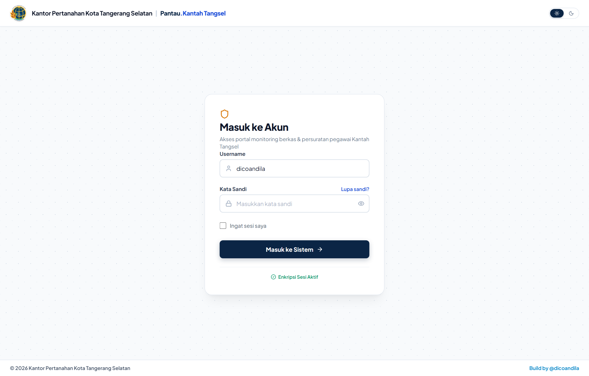

### Langkah-langkah Masuk ke Sistem:
1. **Username**: Masukkan *username* akun pegawai Anda (tidak peka huruf besar/kecil).
2. **Kata Sandi**: Masukkan kata sandi akun Anda. Klik ikon **Mata (`👁️`)** di sisi kanan kolom untuk melihat atau menyembunyikan karakter sandi.
3. **Ingat Sesi Saya**:
   - **Dicentang**: Sesi login Anda tetap tersimpan meskipun browser ditutup.
   - **Tidak Dicentang**: Sesi akan otomatis berakhir ketika jendela browser ditutup demi keamanan pada komputer bersama.
4. **Mode Tampilan (Siang / Malam)**: Gunakan tombol pengalih tema (**☀️ / 🌙**) di pojok kanan atas untuk mengganti tampilan *Light Mode* atau *Dark Mode*.
5. **Lupa Sandi?**: Klik tautan **Lupa sandi?** untuk melihat petunjuk menghubungi Administrator guna melakukan *reset* kata sandi.
6. Klik tombol **Masuk ke Sistem →** untuk melanjutkan ke Portal Utama.

---

## 2. Portal Utama (Home Hub) & Navigasi Atas

Setelah berhasil login, Anda akan disambut oleh halaman **Home Hub (`/`)** yang berfungsi sebagai pusat kendali seluruh modul aplikasi.

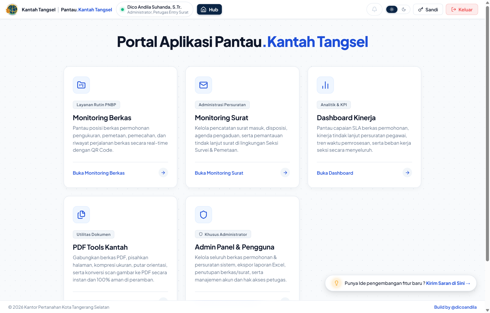

### Penjelasan Komponen Utama:
- **Bilah Navigasi Atas (Navbar)**:
  - **Logo & Identitas Kantah**: Menampilkan lambang resmi Kementerian ATR/BPN, nama instansi Kantor Pertanahan Kota Tangerang Selatan, serta nama aplikasi.
  - **Tombol Navigasi Hub**: Klik tombol **Hub** (berikon rumah) pada bilah navigasi dari halaman mana saja untuk kembali ke portal utama (**Home Hub**).
  - **Menu Kontekstual**: Menyesuaikan secara pintar dengan modul yang sedang Anda buka (misalnya menampilkan tombol *Berkas*, *Scan QR*, *Surat*, *KPI*, dan *Admin Panel*).
  - **Tombol Tema (☀️/🌙)**: Mengubah skema warna aplikasi secara instan.
  - **Chip Profil Pengguna**: Menampilkan foto/inisial, nama lengkap, dan jabatan Anda. Klik bagian ini untuk membuka halaman **Profil & Ruang Kerja DWG**.
  - **Tombol Keluar**: Mengakhiri sesi login Anda dengan aman.
- **5 Kartu Modul Utama (Home Hub Grid)**:
  1. **Monitoring Berkas**: Pelacakan posisi fisik berkas permohonan Survei & Pemetaan (Alur K1 dan K2), perhitungan hari kerja SLA/SOP, pengiriman transit, dan serah terima berkas.
  2. **Monitoring Persuratan**: Pelacakan surat masuk, pencetakan QR Agenda, lampiran PDF, pengiriman surat antar meja, dan disposisi persuratan.
  3. **Dashboard Kinerja**: Pemantauan capaian SLA berkas permohonan, kinerja tindak lanjut persuratan pegawai, tren waktu pemrosesan, serta beban kerja seksi secara menyeluruh.
  4. **PDF Tools Kantah**: Alat pengolah file PDF mandiri (*Merge, Split, Compress, Rotate, Image to PDF*) tanpa perlu mengunggah dokumen ke internet luar.
  5. **Admin Panel & Pengguna** *(Khusus Administrator)*: Manajemen seluruh data berkas/surat, unduh laporan Excel (`.xlsx`), kelola akun pegawai, dan pantau pengguna online.

> [!NOTE]
> Modul **Profil & Ruang Kerja DWG** tidak berada pada kartu grid Home Hub, melainkan diakses secara langsung dari bilah navigasi (Navbar) dengan mengeklik **Chip Profil Pengguna** di pojok kanan atas.

---

### Panduan Khusus: Lonceng Notifikasi Suara & Integrasi Bot Telegram (`@pantaukantahtangsel_bot`)

Di pojok kanan atas bilah navigasi (Navbar) terdapat ikon **Lonceng Notifikasi (`🔔`)** yang berfungsi sebagai pusat peringatan berkas kiriman (*Transit*) sekaligus panel penghubung **Bot Telegram Resmi Kantor Pertanahan**.

#### A. Fungsi Lonceng Notifikasi & Peringatan Suara Otomatis

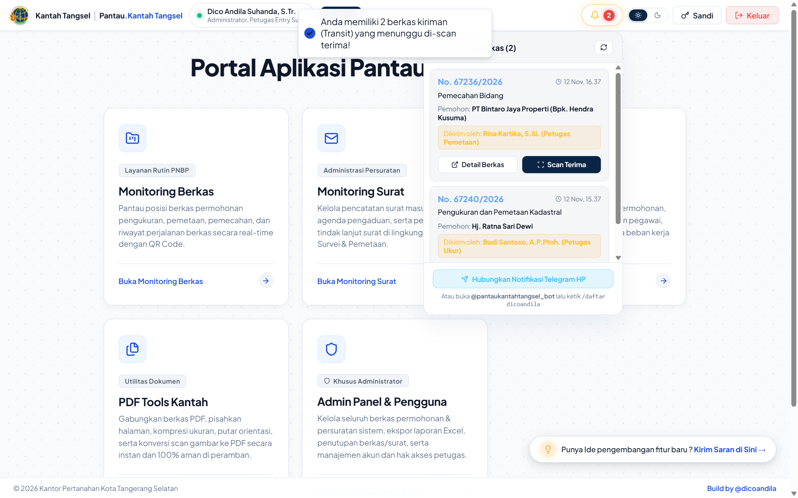

1. **Indikator Angka Merah (*Badge Count*)**:
   - Menampilkan jumlah berkas permohonan yang sedang dikirim (*Transit*) menuju meja Anda dan menunggu untuk di-scan terima.
2. **Nada Panggilan Otomatis (*Web Audio Chime* ~3,2 Detik)**:
   - Saat Anda baru saja login (dan terdapat berkas kiriman yang menunggu) atau saat rekan kerja baru saja mengirimkan berkas ke meja Anda, aplikasi otomatis membunyikan **nada *chime* pengumuman 2 putaran** melalui speaker PC/HP Anda serta memunculkan *popup* pemberitahuan di bagian atas layar.
   - Sistem melakukan pengecekan otomatis setiap **20 detik** di latar belakang tanpa perlu memuat ulang halaman.
3. **Daftar Kiriman Berkas & Tombol Pintas**:
   - Klik ikon **Lonceng (`🔔`)** untuk membuka daftar **Kiriman Berkas**.
   - Setiap kartu menampilkan **Nomor Berkas**, **Waktu Kirim**, **Jenis Kegiatan**, **Nama Pemohon**, serta **Nama Petugas Pengirim** (kotak kuning).
   - Tersedia 2 tombol tindakan langsung pada setiap berkas:
     - **`Detail Berkas`**: Membuka halaman rincian berkas dan riwayat perjalanannya.
     - **`Scan Terima`**: Langsung membuka halaman **Scanner QR** untuk memindai map fisik berkas yang tiba di meja Anda.

---

#### B. Cara Menghubungkan Akun dengan Bot Telegram HP (`@pantaukantahtangsel_bot`)

Agar Anda tetap menerima pemberitahuan *real-time* di ponsel meskipun sedang tidak membuka komputer/browser, hubungkan akun Anda ke Bot Telegram resmi **`@pantaukantahtangsel_bot`**:

1. **Melalui Menu Lonceng Notifikasi**:
   - Klik ikon **Lonceng (`🔔`)** di Navbar atas.
   - Pada bagian bawah panel lonceng, klik tombol biru **`Hubungkan Notifikasi Telegram HP`** (atau buka aplikasi Telegram dan cari **`@pantaukantahtangsel_bot`**).
2. **Verifikasi Keamanan dengan Kata Sandi (`/daftar`)**:
   - Di ruang chat Telegram **`@pantaukantahtangsel_bot`**, ketik perintah berikut:
     ```text
     /daftar <username> <password>
     ```
     *(Contoh: `/daftar dicoandila rahasia123`)*
   - Verifikasi kata sandi akun web ini diwajibkan agar pihak luar tidak dapat menautkan akun pegawai tanpa izin.
   - Demi keamanan, silakan hapus pesan perintah `/daftar` Anda di chat Telegram setelah bot membalas bahwa penautan berhasil.

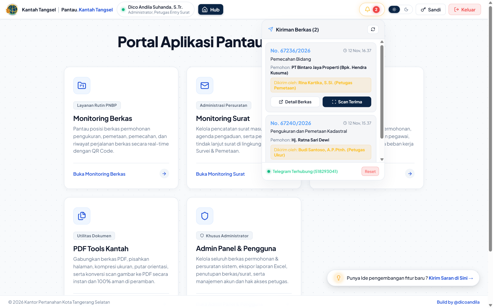

3. **Indikator Terhubung & Fitur Reset**:
   - Setelah berhasil ditautkan, bagian bawah menu Lonceng akan berubah menjadi indikator hijau **`● Telegram Terhubung (Chat ID)`**.
   - Setiap kali ada petugas yang **Mengirim Berkas (*Transit*)**, **Membatalkan Kiriman (*Batal Kirim*)**, atau **Mengirim File Peta `.dwg`** kepada Anda, bot akan langsung mengirimkan pesan rinciannya ke Telegram HP Anda.
   - Jika Anda berganti nomor/akun Telegram, cukup klik tombol merah **`Reset`** di samping indikator hijau untuk memutuskan tautan lama dan menghubungkan akun Telegram baru.

#### C. Daftar Perintah Interaktif pada Bot `@pantaukantahtangsel_bot`

| Perintah di Chat Bot | Fungsi / Kegunaan |
| :--- | :--- |
| **`/start`** | Menampilkan pesan selamat datang, panduan penautan akun, dan informasi *Chat ID* Telegram Anda. |
| **`/daftar <username> <password>`** | Memverifikasi akun pegawai dan menautkan notifikasi *real-time* ke Telegram HP Anda. |
| **`/cek`** atau **`/status`** | Memeriksa status koneksi akun Anda beserta jumlah berkas *transit* yang saat ini sedang menunggu di meja Anda. |
| **`/stop`** atau **`/putus`** | Memutuskan tautan notifikasi Telegram langsung dari ponsel Anda. |

---

### Panduan Khusus: Ubah Kata Sandi Mandiri (`🔑 Sandi`)

Setiap pengguna dapat mengganti kata sandi akunnya secara mandiri kapan saja melalui tombol **`🔑 Sandi`** di pojok kanan atas bilah navigasi (Navbar):

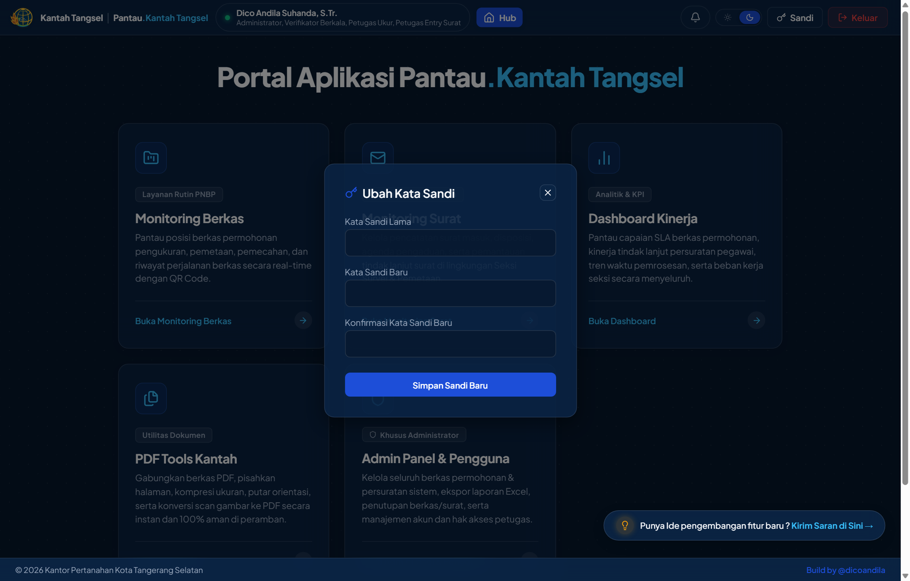

1. Klik tombol **`🔑 Sandi`** di sebelah tombol tema (☀️/🌙).
2. Masukkan **Kata Sandi Lama**, **Kata Sandi Baru**, dan **Konfirmasi Kata Sandi Baru**.
3. Klik **`Simpan Sandi Baru`** untuk langsung memperbarui kata sandi akun Anda.

---

### Panduan Khusus: Kotak Saran & Ide Pengembangan Fitur (`💡 Kirim Saran di Sini`)

Di pojok kanan bawah halaman **Home Hub (`/`)** terdapat tombol melayang **`💡 Punya Ide pengembangan fitur baru? Kirim Saran di Sini →`** yang memungkinkan seluruh pegawai menyampaikan masukan pengembangan aplikasi secara langsung.

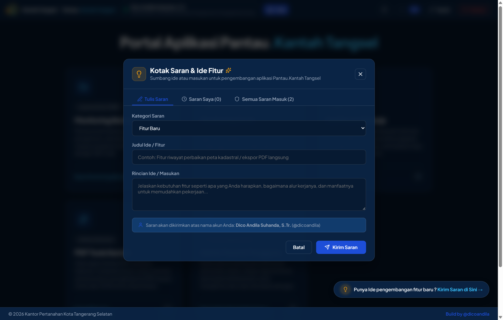

1. **Tab `Tulis Saran`**:
   - Pilih **Kategori Saran** (*Fitur Baru*, *Alur Kerja & Efisiensi SOP*, *Perbaikan Tampilan UI/UX*, *Integrasi & Otomasi*, *Laporan & Rekapitulasi Data*, atau *Lainnya*).
   - Isi **Judul Ide / Fitur** dan **Rincian Ide / Masukan**, lalu klik **`Kirim Saran`**.
2. **Tab `Saran Saya` & `Semua Saran Masuk`**:
   - Pantau seluruh usulan fitur yang telah dikirimkan beserta status tindak lanjutnya (**`Menunggu Review`**, **`Ditinjau`**, **`Diterima`**, **`Selesai`**, atau **`Ditolak`**) dan balasan resmi dari Administrator.
   - Khusus **Administrator**, tersedia tombol pembaruan status dan catatan tanggapan langsung pada setiap kartu saran.

---

## 3. Modul Monitoring Berkas Permohonan (`/berkas`)

Halaman **Monitoring Berkas** menyajikan gambaran menyeluruh mengenai posisi berkas permohonan di Seksi Survei dan Pemetaan secara *real-time*.

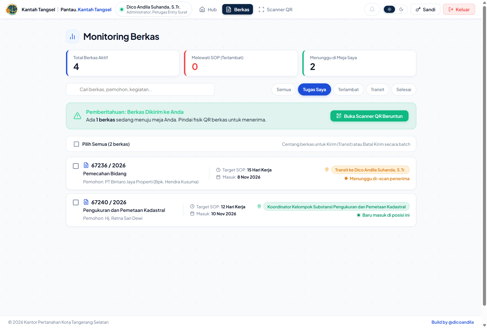

### Fitur-fitur pada Dashboard Monitoring Berkas:
1. **Kartu Ringkasan Cepat (Bagian Atas)**:
   - **Berkas Aktif**: Jumlah seluruh berkas permohonan yang sedang berjalan (belum *Selesai* atau *Ditutup*).
   - **Melewati SOP**: Jumlah berkas aktif yang telah melampaui batas hari kerja SLA sesuai jenis kegiatannya.
   - **Berkas di Lokasi Saya**: Jumlah berkas yang saat ini berada pada tanggung jawab Anda atau sedang dikirim (*transit*) kepada Anda.
2. **Kotak Masuk Kiriman Berkas (Transit)**:
   - Muncul otomatis di bagian atas apabila ada rekan petugas yang mengirimkan berkas kepada Anda. Anda dapat langsung melihat pengirimnya atau memindai QR berkas fisik saat berkas tiba di meja Anda.
3. **Grafik Distribusi Posisi Berkas (Alur K1 & K2)**:
   - Menampilkan diagram batang jumlah berkas pada setiap tahapan:
     - **Alur K1 (7 Tahap)**: Mulai dari *Loket Pendaftaran (Entry)* → *Petugas Ukur* → *Petugas Pemetaan* → *Petugas Alih Media* → *Koordinator K1* → *Kepala Seksi SP* → *Loket Penyerahan*.
     - **Alur K2 / Rutin (11 Tahap)**: Mencakup verifikasi *Asisten Surveyor Kadastral (ASK)* dan tahapan lintas seksi ke *Seksi PHP*.
   - **Interaktif**: Klik salah satu baris tahapan pada grafik untuk langsung menyaring daftar berkas yang sedang berada di tahapan tersebut.
4. **Fitur "Cari Berkas Petugas"**:
   - Memungkinkan Anda mencari dan memantau beban berkas yang sedang dipegang oleh petugas tertentu beserta rincian jenis kegiatannya.
5. **Tabel Daftar Berkas & Fitur Pencarian**:
   - Gunakan tab filter **Semua**, **Tugas Saya**, **Terlambat**, **Transit**, atau **Selesai**, serta kotak pencarian untuk menyaring berkas secara instan.

---

### Panduan Khusus: Kirim Berkas Secara Batch (Massal) & Batal Kirim Batch

Apabila Anda ingin menyerahkan banyak berkas sekaligus ke satu petugas tujuan yang sama (atau membatalkan pengiriman beberapa berkas sekaligus), Anda tidak perlu membuka halaman detail berkas satu per satu. Gunakan fitur **Kirim Batch** langsung dari halaman **Monitoring Berkas (`/berkas`)**:

#### Langkah 1: Pilih / Centang Berkas yang Akan Dikirim atau Dibatalkan

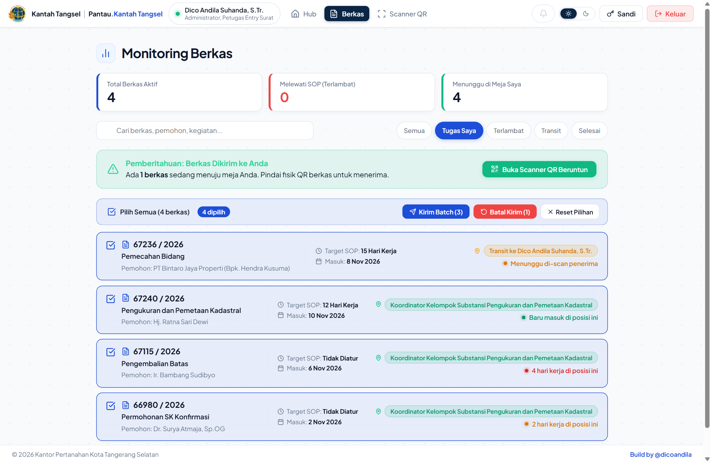

1. Pada daftar berkas di halaman **Monitoring Berkas**, klik **kotak centang (`☑️`)** di sebelah kiri nomor berkas yang ingin Anda kirim, atau klik tombol **`Pilih Semua`** pada bilah di atas daftar berkas untuk memilih seluruh berkas yang memenuhi syarat sekaligus.
2. Sistem secara cerdas memilah berkas yang Anda centang ke dalam 2 tombol aksi otomatis pada bilah kontrol:
   - **Tombol Biru `Kirim Batch (Jumlah)`**: Menghitung jumlah berkas terpilih yang saat ini sedang berada di meja Anda dan siap dikirim (*transit*).
   - **Tombol Merah `Batal Kirim (Jumlah)`**: Menghitung jumlah berkas terpilih yang sedang berstatus *Transit* (dikirim oleh Anda/Admin) dan dapat dibatalkan pengirimannya secara massal.
   - **Tombol `× Reset Pilihan`**: Menghapus seluruh centang pilihan berkas.

#### Langkah 2: Pilih Petugas Tujuan pada Modal Kirim Batch

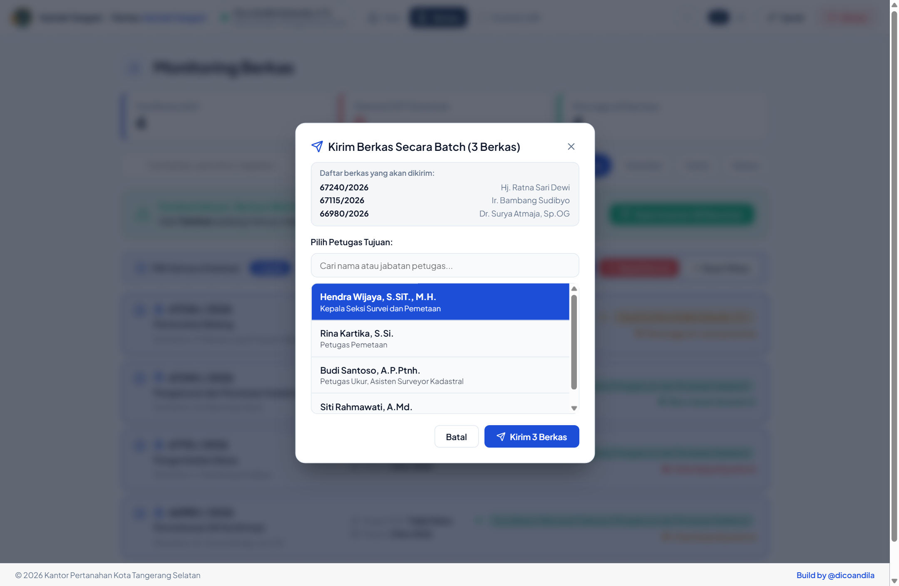

1. Setelah mencentang berkas, klik tombol biru **`Kirim Batch`**.
2. Akan muncul jendela pop-up **`Kirim Berkas Secara Batch`** yang menampilkan:
   - **Daftar berkas yang akan dikirim** (lengkap dengan Nomor Berkas dan Nama Pemohon) untuk Anda periksa kembali.
   - **Kolom Pencarian Petugas (`Cari nama atau jabatan petugas...`)** untuk mencari nama rekan penerima dengan cepat.
   - **Daftar Petugas Tujuan**: Klik nama petugas yang dituju hingga baris namanya berwarna biru.
3. Klik tombol **`Kirim (Jumlah) Berkas`**:
   - Seluruh berkas terpilih akan langsung berubah status menjadi **Transit** menuju meja petugas tersebut.
   - Petugas penerima akan langsung mendapatkan **Notifikasi Lonceng Suara** di aplikasi web dan **Notifikasi Bot Telegram** untuk seluruh berkas yang dikirimkan.

---

## 4. Entri Berkas Permohonan Baru & Cetak QR Code (`/entry`)

Petugas Loket Pendaftaran atau Administrator dapat mendaftarkan berkas permohonan baru dengan mengeklik tombol khusus **Entri Berkas Baru** di kanan atas halaman Monitoring Berkas (identik dengan tombol *Entry Surat Baru* pada Monitoring Surat).

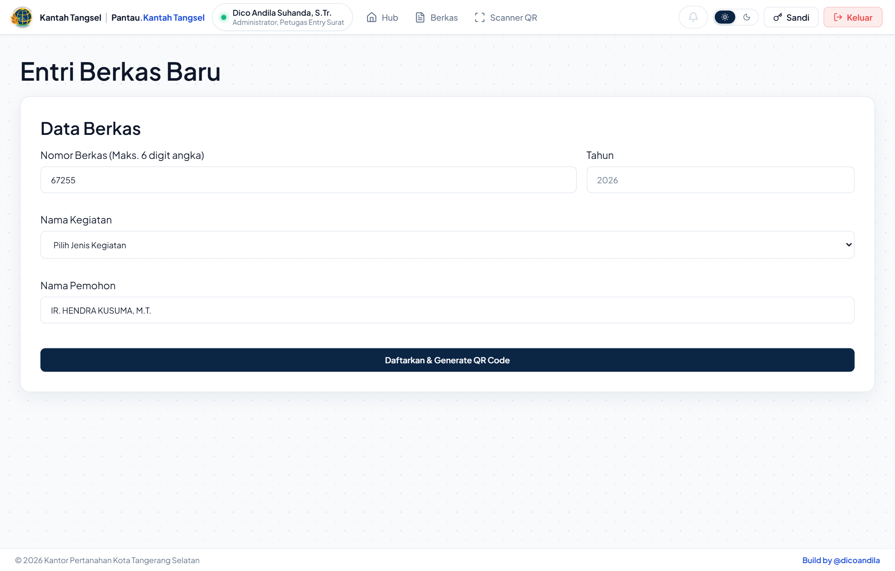

### Cara Mendaftarkan Berkas Baru:
1. **Nomor Berkas & Tahun Berkas**: Masukkan nomor berkas permohonan (contoh: `67255`) dan tahun berkas (`2026`). Sistem secara otomatis menerapkan **Kunci Anti-Duplikasi** agar kombinasi Nomor + Tahun yang sama tidak dapat diinput ganda.
2. **Nama Pemohon**: Isi nama lengkap pemohon atau badan hukum.
3. **Jenis Kegiatan**: Pilih salah satu dari **17 jenis layanan Survei & Pemetaan** (seperti *Pemecahan Bidang*, *Pengukuran Dan Pemetaan Kadastral*, *Pengembalian Batas*, *Permohonan SK Konfirmasi*, dll.). Sistem otomatis menetapkan target hari kerja SLA/SOP sesuai kegiatan yang dipilih.
4. **Jenis Hak & Nomor Hak**: Pilih jenis hak (*Hak Milik*, *HGB*, *Hak Pakai*, *Hak Pengelolaan*, *Wakaf*, atau *Belum Terdaftar*) dan masukkan nomor haknya.
5. **Kecamatan & Kelurahan**: Pilih Kecamatan di wilayah Kota Tangerang Selatan; daftar Kelurahan akan menyesuaikan secara otomatis.
6. **Catatan Awal (Opsional)**: Tambahkan informasi tambahan bila diperlukan.
7. Klik **Simpan & Buat QR Code**:
   - Panel di sebelah kanan akan langsung menampilkan **Slip QR Code Berkas** berlogo ATR/BPN.
   - Klik tombol **Cetak QR Code** untuk mencetak slip tempel berkas fisik.

---

## 5. Detail Berkas, Kirim Transit, Disposisi & Jeda SOP (`/file/:qrcode`)

Mengklik salah satu baris berkas pada tabel Monitoring akan membuka halaman **Detail Berkas**.

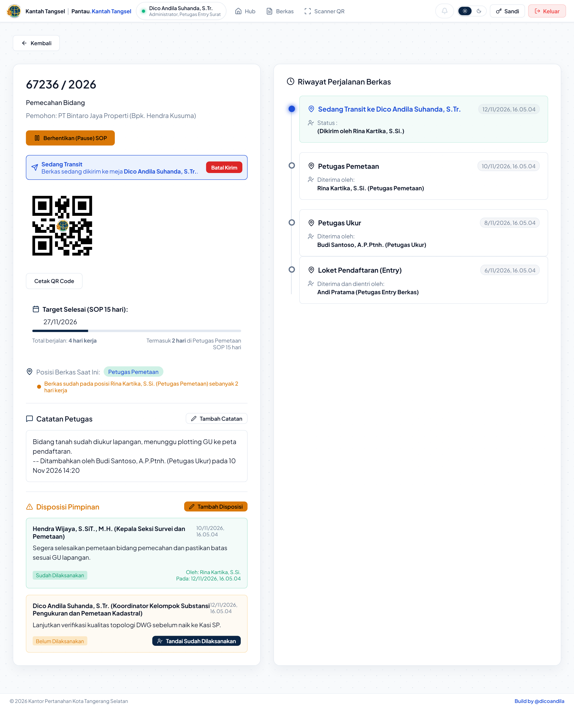

### Fitur-fitur pada Halaman Detail Berkas:
1. **Informasi Lengkap & Indikator SLA/SOP**:
   - Menampilkan Nomor Berkas, Pemohon, Jenis Kegiatan, Lokasi Kecamatan/Kelurahan, Posisi Tahapan Saat Ini, serta jumlah **Hari Kerja Berjalan** dibandingkan batas target SOP (hijau = aman, kuning = mendekati batas, merah = melewati SOP).
2. **Kirim Berkas (Transit Antar Petugas)**:
   - Klik tombol **Kirim Berkas (Transit)**, pilih nama petugas tujuan melalui kolom pencarian, lalu konfirmasi.
   - Petugas tujuan akan langsung menerima **Notifikasi Telegram Otomatis** di ponselnya bahwa berkas sedang dikirim menuju mejanya.
3. **Hentikan Sementara / Lanjutkan SOP (Khusus Koordinator, Kasi SP, & Admin)**:
   - Jika berkas terkendala kelengkapan dokumen dari pemohon atau kendala eksternal lapangan, klik tombol **Hentikan SOP (Pause)**. Selama berkas dijeda, arloji perhitungan hari kerja SLA akan berhenti dan baru dihitung kembali saat tombol **Lanjutkan SOP (Resume)** ditekan.
4. **Catatan Berkas & Lembar Disposisi Digital**:
   - **Catatan Berkas**: Petugas dapat memperbarui catatan teknis berkas; sistem otomatis membubuhkan jejak nama petugas, jabatan, dan waktu perubahan.
   - **Disposisi**: Pejabat/Koordinator/Petugas dapat menambahkan instruksi disposisi beruntun yang tersimpan rapi lengkap dengan stempel waktu.
5. **Riwayat Perjalanan Berkas (Timeline)**:
   - Menampilkan urutan kronologis perpindahan berkas dari meja ke meja, lengkap dengan nama petugas pemindai dan durasi waktu di setiap tahapan.
6. **Slip QR Code & Cetak Ulang**:
   - Tersedia di panel kanan untuk mencetak ulang label QR Code kapan saja.

---

## 6. Scan QR Berkas: Mode Scan Satuan vs Mode Scan Batch (Beruntun) (`/scan`)

Halaman **Scanner QR Code (`/scan`)** digunakan oleh setiap petugas tahapan saat menerima fisik berkas di mejanya agar posisi berkas berpindah secara resmi ke akun dan tahapan petugas tersebut. Halaman ini menyediakan **2 Mode Pemindaian** yang dapat dipilih sesuai jumlah berkas yang sedang diterima:

---

### A. Mode Scan Satuan (Default)

Gunakan **Mode Scan Satuan** apabila Anda hanya menerima **1 (satu) berkas** dan ingin melihat konfirmasi detail berkas sebelum menyetujui penerimaan.

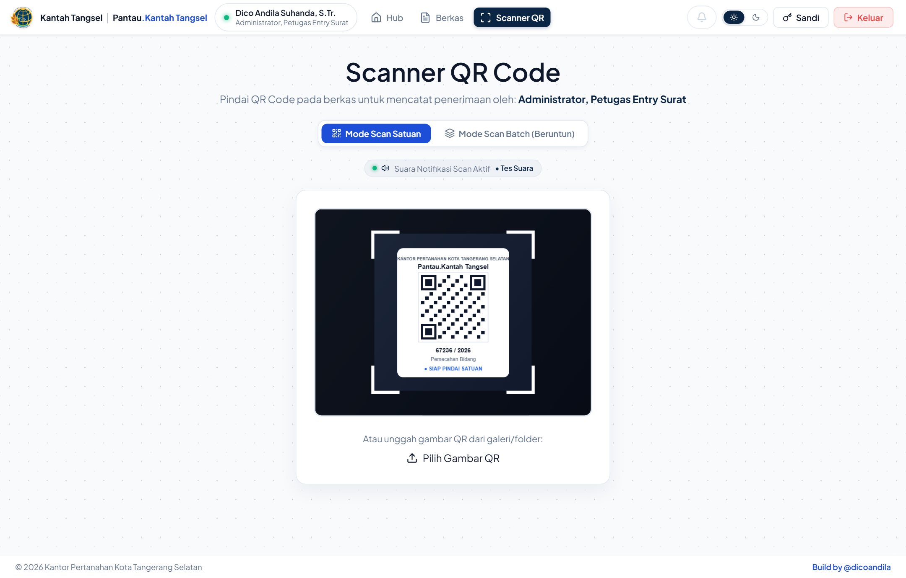

#### Cara Menggunakan Mode Scan Satuan:
1. Pastikan tombol biru **`Mode Scan Satuan`** terpilih di bagian atas.
2. Arahkan kamera ke stiker QR Code pada map berkas (atau klik tombol **`Pilih Gambar QR`** untuk memilih foto QR dari perangkat).
3. Begitu QR Code terbaca, **kamera akan otomatis berhenti** dan sistem menampilkan layar **Konfirmasi Penerimaan**:
   - Bagi **Petugas 1 Jabatan**: Muncul konfirmasi *"Anda yakin akan menerima berkas ini? (Nomor Berkas & Nama Pemohon)"* dengan tombol **Ya, Terima** atau **Tidak**.
   - Bagi **Petugas Multi-Jabatan (*Multi-Role*)**: Jika Anda memegang lebih dari 1 jabatan pada alur berkas tersebut, sistem akan menampilkan pilihan **Pilih Posisi Berkas** atau **Konfirmasi Lanjutan Pintar (*Smart Confirmation*)** untuk melanjutkan berkas ke jabatan berikutnya.
4. Setelah diterima, muncul layar **Berhasil!** dengan tombol **Ke Monitoring Berkas** atau **Scan Lagi**.

---

### B. Mode Scan Batch / Beruntun (Untuk Banyak Berkas Sekaligus)

Gunakan **Mode Scan Batch (Beruntun)** apabila Anda menerima **tumpukan banyak berkas sekaligus** di meja Anda agar tidak perlu menekan tombol konfirmasi berulang-ulang untuk setiap berkas.

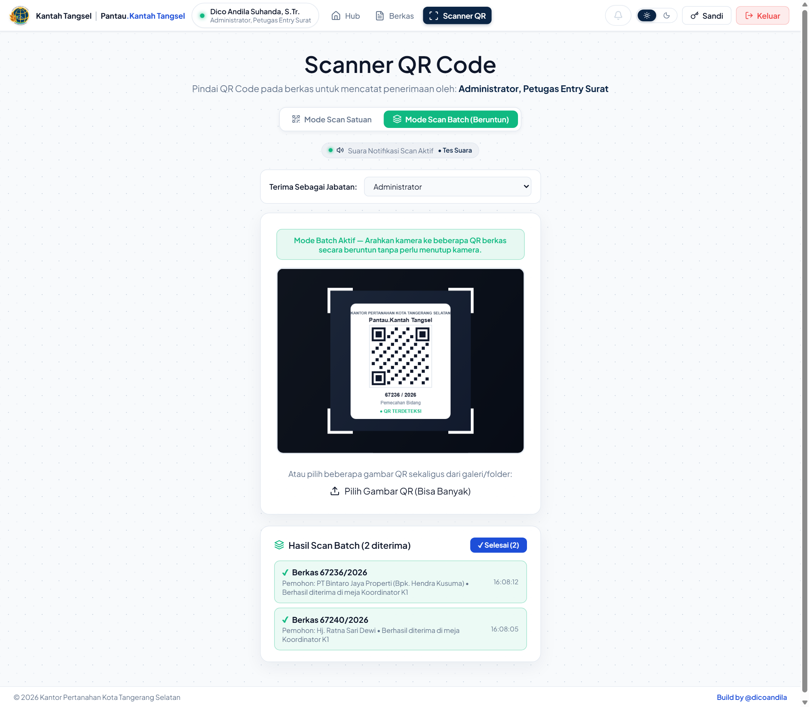

#### Cara Menggunakan Mode Scan Batch (Beruntun):
1. Klik tombol hijau **`Mode Scan Batch (Beruntun)`** di bagian atas halaman.
2. **Pilih Jabatan Penerima *(Khusus Pengguna Multi-Jabatan)***:
   - Jika akun Anda memiliki lebih dari satu jabatan/role, pilih terlebih dahulu jabatan yang akan digunakan pada menu dropdown **`Terima Sebagai Jabatan`** di atas kamera, sehingga sistem tidak perlu menanyakan pilihan jabatan pada setiap berkas yang di-scan.
3. **Pindai Berkas Satu per Satu Tanpa Henti**:
   - Kamera **tetap menyala terus-menerus**. Cukup lewatkan stiker QR berkas pertama, kedua, ketiga, dan seterusnya di depan kamera (atau klik **`Pilih Gambar QR (Bisa Banyak)`** untuk mengunggah banyak gambar QR sekaligus).
   - Sistem dilengkapi **Pelindung Anti-Scan Ganda (3,5 Detik)** sehingga berkas yang sama tidak akan tercatat dua kali apabila masih berada di depan kamera.
4. **Pantau Daftar `Hasil Scan Batch` di Bagian Bawah**:
   - Setiap berkas yang dipindai langsung masuk ke panel **Hasil Scan Batch** di bawah kamera:
     - **Kotak Hijau (`✔`)**: Berkas berhasil diterima di meja Anda disertai bunyi *chime* sukses.
     - **Kotak Merah (`!`)**: Berkas ditolak (misalnya belum dikirim *transit* ke meja Anda atau sudah berstatus *Selesai*) disertai bunyi peringatan gagal dan alasan penolakannya.
5. Setelah seluruh tumpukan berkas selesai dipindai, klik tombol biru **`✓ Selesai (Jumlah Diterima)`** untuk kembali ke halaman Monitoring Berkas.

---

### Perbandingan Cepat: Kapan Menggunakan Satuan vs Batch?

| Fitur / Perilaku | **Mode Scan Satuan** | **Mode Scan Batch (Beruntun)** |
| :--- | :--- | :--- |
| **Peruntukan Utama** | Menerima 1 berkas tunggal | Menerima banyak tumpukan berkas sekaligus |
| **Kondisi Kamera** | Berhenti otomatis setelah 1 QR terbaca | Tetap menyala terus-menerus tanpa jeda |
| **Konfirmasi Penerimaan** | Menampilkan layar konfirmasi per berkas | Langsung mencatat penerimaan secara otomatis |
| **Pilihan Multi-Jabatan** | Ditanyakan saat berkas dipindai | Dipilih sekali di awal pada dropdown `Terima Sebagai Jabatan` |
| **Unggah Gambar QR** | 1 file gambar per proses | Mendukung *multi-select* banyak gambar QR sekaligus |

---

## 7. Modul Monitoring Persuratan / Surat Masuk (`/surat`)

Selain berkas permohonan pengukuran, aplikasi menyediakan modul khusus **Monitoring Persuratan** untuk melacak surat masuk (undangan pengadilan, permohonan keterangan teknis kepolisian, surat dinas instansi, dll.).

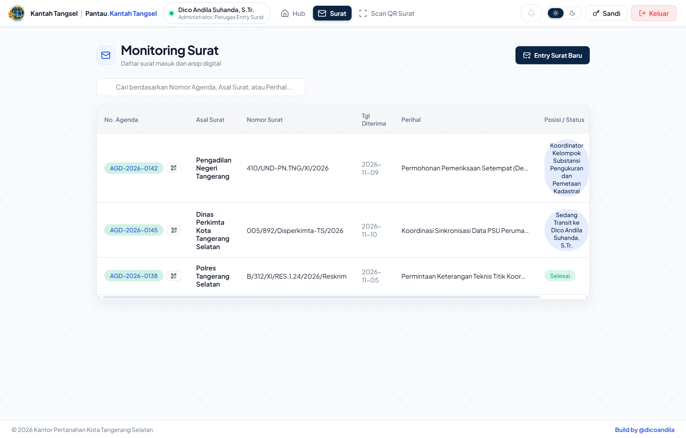

### Fitur Utama Monitoring Persuratan:
1. **Pencarian Cepat**: Cari surat berdasarkan **Nomor Agenda**, **Nomor Surat**, **Asal Surat**, atau **Perihal**.
2. **Akses Dokumen PDF Terproteksi**:
   - Jika surat memiliki lampiran hasil scan PDF, klik tombol **Lihat PDF** untuk membuka dokumen digitalnya secara langsung di tab baru (dilindungi autentikasi token sesi).
3. **Cetak QR Agenda Surat**:
   - Klik ikon **QR Code (`🏁`)** pada baris surat untuk menampilkan modal QR Code Agenda Surat dan mencetaknya ke lembar disposisi fisik.
4. **Navigasi ke Detail & Scan QR Surat**:
   - Klik baris surat untuk melihat **Detail Surat (`/surat/detail/:id`)** guna mengirim transit surat, menulis disposisi surat, atau melihat riwayat perjalanan surat.
   - Klik tombol **Scan QR Surat (`/surat/scan`)** di bagian atas untuk memindai penerimaan fisik surat masuk.

---

### A. Halaman Detail Surat Masuk, Kirim Transit Surat & Disposisi (`/surat/detail/:id`)

Mengklik salah satu surat pada tabel **Monitoring Persuratan** akan membuka halaman **Detail Surat Masuk**:

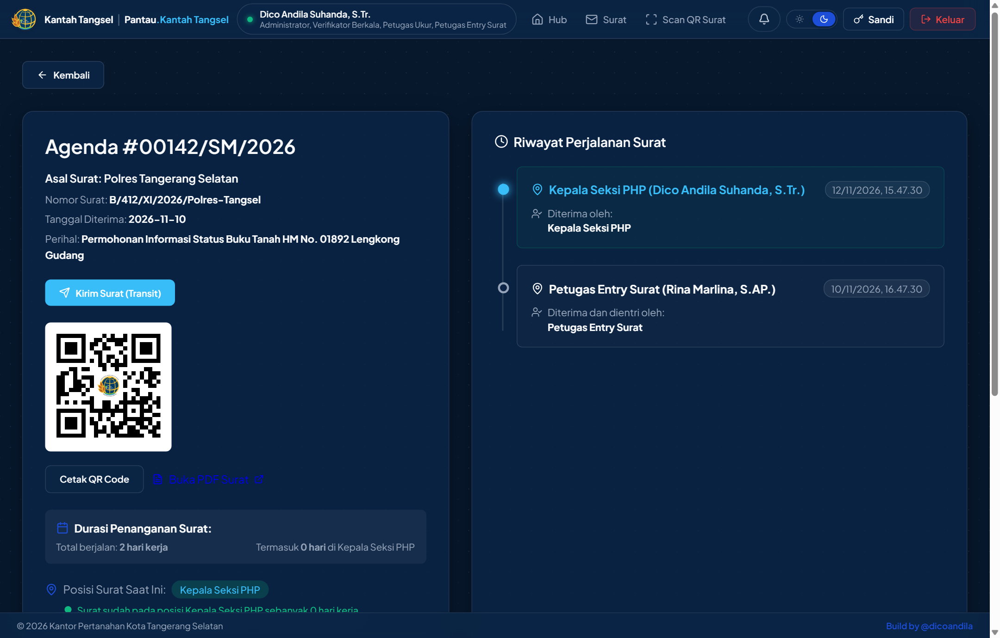

1. **Informasi Agenda & Dokumen PDF**:
   - Menampilkan **Nomor Agenda**, **Asal Surat**, **Nomor Surat**, **Tanggal Diterima**, **Perihal**, dan **Durasi Penanganan Surat (Hari Kerja)**.
   - Klik **`Buka PDF Surat`** untuk membuka atau mengunduh salinan digital PDF surat yang terlampir.
2. **Kirim Surat (*Transit Antar Petugas*) & Cetak QR Code**:
   - Klik tombol biru **`Kirim Surat (Transit)`** untuk mengirimkan surat ke meja pejabat/petugas tujuan (penerima akan mendapatkan notifikasi lonceng & Telegram).
   - Klik **`Cetak QR Code`** di bawah label QR untuk mencetak ulang stiker QR Agenda Surat.
3. **Catatan Tindak Lanjut, Disposisi & Riwayat Perjalanan Surat**:
   - Tambahkan catatan tindak lanjut maupun **Lembar Disposisi Surat** di bagian bawah, serta pantau kronologi perpindahan surat pada panel **Riwayat Perjalanan Surat** di sebelah kanan.

---

### B. Halaman Scan QR Surat Masuk & Konfirmasi Tindak Lanjut (`/surat/scan`)

Saat fisik surat tiba di meja Anda (atau saat Anda mengklik tombol **`Scan Terima`** dari Lonceng Notifikasi), gunakan halaman **Scan QR Surat (`/surat/scan`)**:

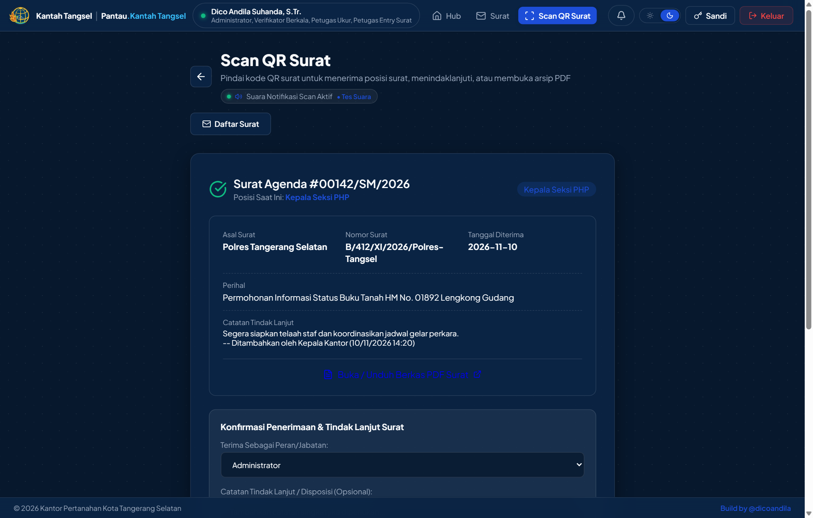

1. **Pindai Kamera atau Unggah Foto QR**:
   - Arahkan kamera ke stiker QR Agenda pada lembar disposisi surat, atau klik **`Unggah Foto QR`**.
2. **Rincian Surat & Konfirmasi Penerimaan**:
   - Setelah QR terbaca, sistem langsung menampilkan kartu **Surat Agenda** lengkap dengan **Asal Surat**, **Nomor Surat**, **Perihal**, **Catatan Tindak Lanjut**, serta tombol **`Buka / Unduh Berkas PDF Surat`**.
   - Pilih jabatan penerima pada dropdown **`Terima Sebagai Peran/Jabatan`** (bila memiliki multi-jabatan) dan isi **`Catatan Tindak Lanjut / Disposisi (Opsional)`**.
3. **Dua Tombol Tindak Lanjut**:
   - Klik **`Terima & Proses Surat Ini`** untuk mencatat bahwa surat resmi berada di meja Anda.
   - Klik tombol hijau **`Selesaikan Tindak Lanjut`** apabila penanganan surat tersebut telah tuntas sepenuhnya.

---

## 8. Entri Surat Masuk & Unggah Lampiran PDF (`/surat/entry`)

Petugas Entry Surat dan Administrator dapat meregistrasi surat masuk baru melalui halaman **Entri Surat Masuk**.

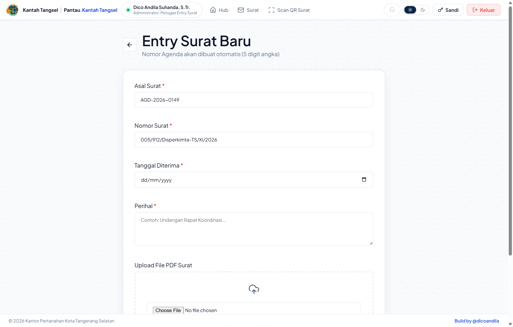

### Langkah-langkah Entri Surat Masuk:
1. **Nomor Agenda & Nomor Surat**: Masukkan nomor agenda internal dan nomor surat resmi yang tertera pada naskah surat.
2. **Tanggal Surat & Tanggal Terima**: Pilih tanggal surat diterbitkan dan tanggal surat diterima di Kantor Pertanahan.
3. **Asal Surat & Perihal**: Ketik instansi/pihak pengirim surat beserta ringkasan perihal surat.
4. **Unggah File PDF Surat (Opsional, Maks. 10 MB)**:
   - Pilih file hasil pemindaian surat berformat `.pdf`.
   - Sistem akan menampilkan **Pratinjau Halaman Pertama PDF** secara otomatis di layar sebelum Anda menyimpan data.
5. Klik **Simpan & Buat QR Surat** untuk menyimpan data sekaligus menampilkan label QR Code Agenda Surat yang siap dicetak.

---

## 9. Dashboard Kinerja Petugas (KPI) & Top 50 Berkas Terlama (`/kpi`)

Halaman **Analitik & KPI** memberikan transparansi beban kerja dan kecepatan penyelesaian berkas maupun persuratan bagi seluruh jajaran Seksi Survei dan Pemetaan.

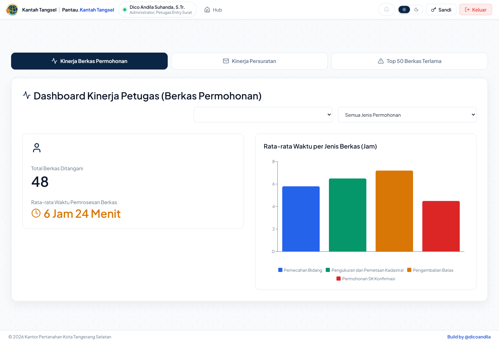

### 3 Tab Analitik pada Halaman KPI:
1. **Tab `Kinerja Berkas Permohonan`**:
   - Menampilkan grafik perbandingan **Jumlah Interaksi Berkas** dan **Rata-rata Waktu Penyelesaian (Jam Kerja)** per petugas.
   - Tersedia filter dropdown **Pilih Nama Petugas** dan **Pilih Jenis Kegiatan** untuk melihat rincian (*breakdown*) performa spesifik masing-masing pegawai.

2. **Tab `Kinerja Persuratan`**:

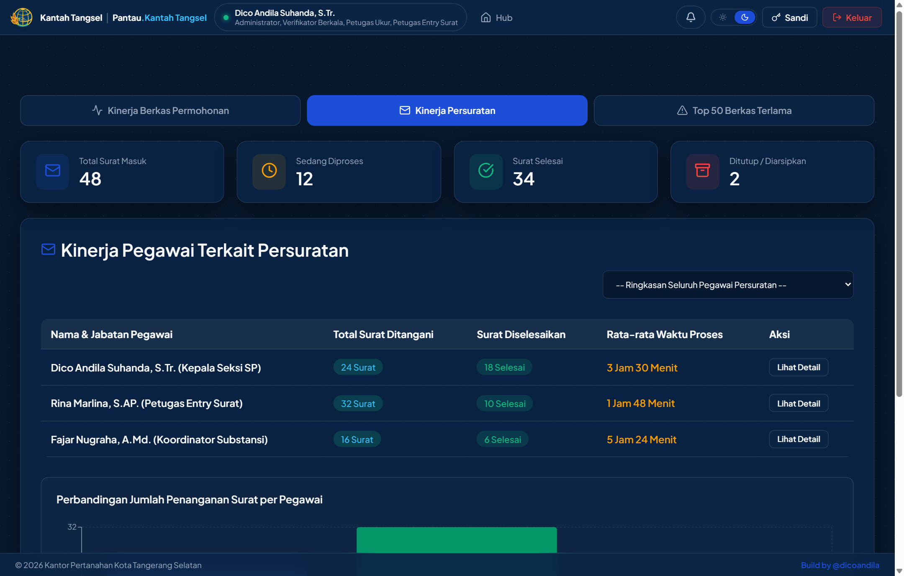

   - Menampilkan 4 kartu ringkasan (**Total Surat Masuk**, **Sedang Diproses**, **Surat Selesai**, dan **Ditutup / Diarsipkan**).
   - Menyajikan tabel **Kinerja Pegawai Terkait Persuratan** lengkap dengan **Total Surat Ditangani**, **Surat Diselesaikan**, **Rata-rata Waktu Proses**, serta tombol **`Lihat Detail`** dan grafik perbandingan penanganan surat per pegawai berdasarkan instansi asal surat.

3. **Tab `Top 50 Berkas Terlama (Masih Proses)`**:

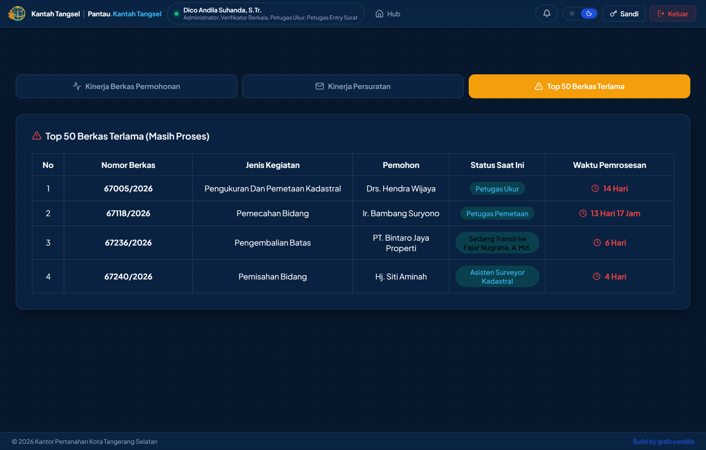

   - Menampilkan daftar peringkat **50 berkas permohonan aktif** yang memiliki durasi hari kerja berjalan paling lama (otomatis mengecualikan hari Sabtu, Minggu, hari libur nasional, dan durasi jeda/*pause*), lengkap dengan indikator apabila berkas sedang *Transit*, sehingga pimpinan dan koordinator dapat melakukan percepatan (*debottlenecking*) secara tepat sasaran.

---

## 10. PDF Tools Kantah (Olah Dokumen Mandiri di Browser) (`/pdf-tools`)

Modul **PDF Tools Kantah** memungkinkan pegawai mengolah dokumen PDF secara langsung di dalam browser (*100% Client-Side Processing*) sehingga dokumen negara tetap aman di perangkat lokal dan tidak pernah diunggah ke situs pihak ketiga di internet.

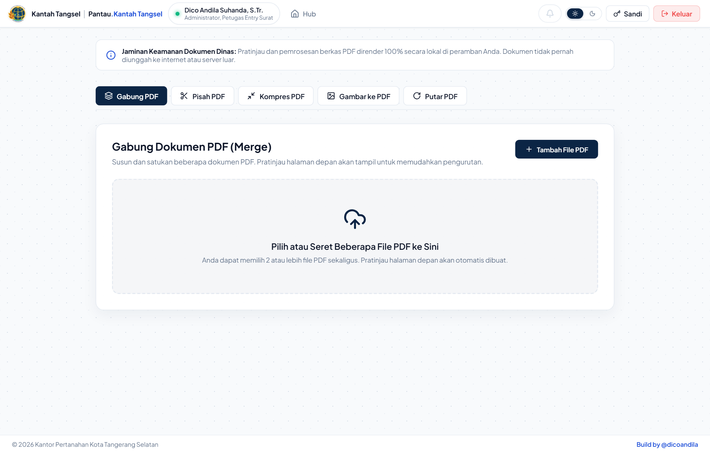

### 5 Fitur Pengolahan PDF yang Tersedia:
1. **Gabung PDF (*Merge PDF*)**: Menggabungkan beberapa file PDF (misalnya berkas permohonan, identitas, dan gambar ukur) menjadi satu file PDF utuh. Anda dapat mengatur urutan file sebelum digabungkan.
2. **Pisah PDF (*Split / Extract PDF*)**: Memisahkan halaman tertentu atau rentang halaman (contoh: `1-3, 5`) dari sebuah dokumen PDF besar.
3. **Kompres PDF (*Compress PDF*)**: Memperkecil ukuran file PDF dengan pilihan tingkat kualitas (*Tinggi, Sedang, atau Maksimal*) agar memenuhi batas ukuran unggah aplikasi KKP.
4. **Putar Halaman (*Rotate PDF*)**: Memutar orientasi halaman PDF sebesar 90°, 180°, atau 270° lalu menyimpannya kembali.
5. **Gambar ke PDF (*Image to PDF*)**: Mengonversi kumpulan foto dokumen (`.jpg` / `.png`) menjadi satu dokumen PDF rapi.

---

## 11. Profil Pengguna, Integrasi Bot Telegram & Ruang Kerja `.dwg` (`/profile`)

Klik nama akun Anda di pojok kanan atas Navbar untuk membuka halaman **Profil Pengguna & Ruang Kerja DWG**.

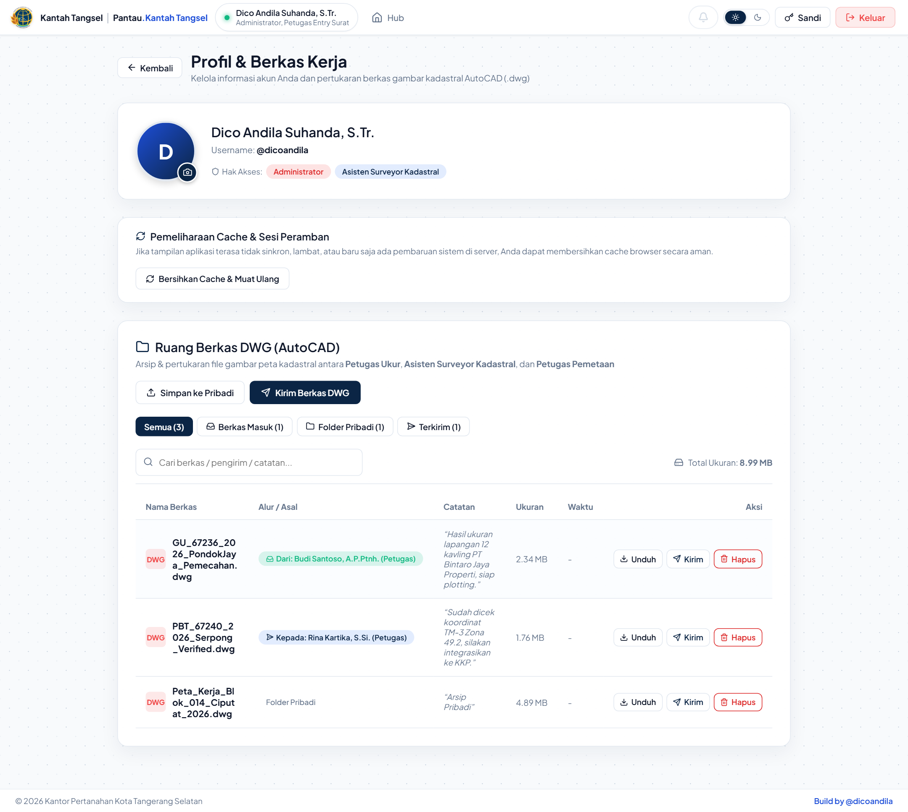

### Fitur-fitur pada Halaman Profil:
1. **Identitas & Foto Profil**:
   - Klik ikon kamera pada avatar Anda untuk mengunggah atau mengganti foto profil (`.jpg`, `.png`, `.webp`).
   - Menampilkan daftar lengkap jabatan/role yang melekat pada akun Anda.
2. **Pemeliharaan Cache & Sesi Peramban (`Bersihkan Cache & Muat Ulang`)**:
   - Apabila tampilan aplikasi di perangkat Anda terasa belum sinkron setelah ada pembaruan sistem di server, klik tombol **`Bersihkan Cache & Muat Ulang`** untuk membersihkan *Service Worker / Cache Storage* peramban secara otomatis dan memuat ulang versi aplikasi terbaru dengan aman.
3. **Ruang Kerja & Pengiriman File AutoCAD (`.dwg`)** *(Khusus Petugas Ukur, Petugas Pemetaan, ASK, & Admin)*:
   - **Simpan ke Folder Pribadi**: Unggah file gambar ukur / peta kerja berformat `.dwg` (hingga 50 MB per file) sebagai cadangan (*cloud backup* internal kantor) yang dapat diunduh dari komputer mana saja di kantor.
   - **4 Tab Pengelompokan**: Pantau seluruh file melalui tab **Semua**, **Berkas Masuk (Inbox)**, **Folder Pribadi**, dan **Terkirim (Sent)** lengkap dengan tombol **Unduh (`.dwg`)** dan **Teruskan (Forward)**.

#### Cara Mengirim / Meneruskan (*Forward*) File Peta `.dwg` ke Rekan Petugas:

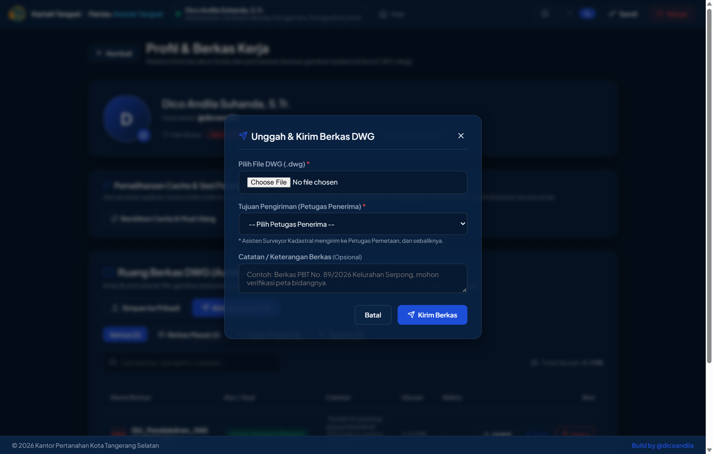

1. Klik tombol biru **`Kirim Berkas DWG`** di kanan atas panel Ruang Berkas DWG (atau klik tombol **`Teruskan`** pada salah satu baris file `.dwg` yang sudah ada).
2. Pada jendela pop-up **`Unggah & Kirim Berkas DWG`**:
   - Pilih file peta kerja berformat **`.dwg`** dari komputer Anda.
   - Pilih **Tujuan Pengiriman (Petugas Penerima)** dari daftar dropdown (*Petugas Ukur*, *Asisten Surveyor Kadastral*, atau *Petugas Pemetaan*).
   - Isi **Catatan / Keterangan Berkas** (misalnya nomor berkas/PBT, koordinat TDT, atau instruksi plotting).
3. Klik **`Kirim Berkas`**: File `.dwg` langsung masuk ke **Berkas Masuk (Inbox)** petugas tujuan disertai pemberitahuan otomatis ke **Bot Telegram HP** penerima.

---

## 12. Admin Panel: Kelola Berkas, Surat & Laporan Excel (`/admin`)

Khusus bagi pengguna dengan hak akses **Administrator**, menu **Admin Panel** menyediakan kendali penuh atas seluruh data berkas permohonan dan persuratan.

### A. Tab `Kelola Berkas Permohonan` & Laporan Excel Berkas

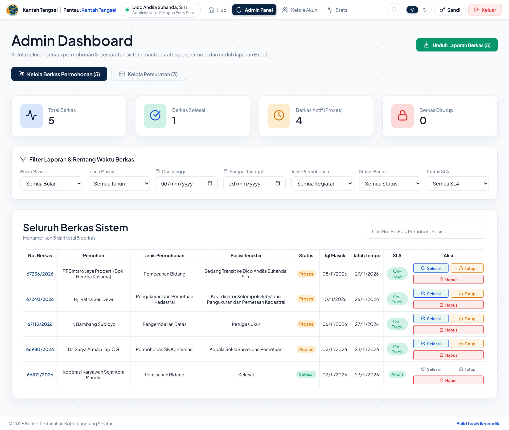

### B. Tab `Kelola Persuratan` & Laporan Excel Surat Masuk

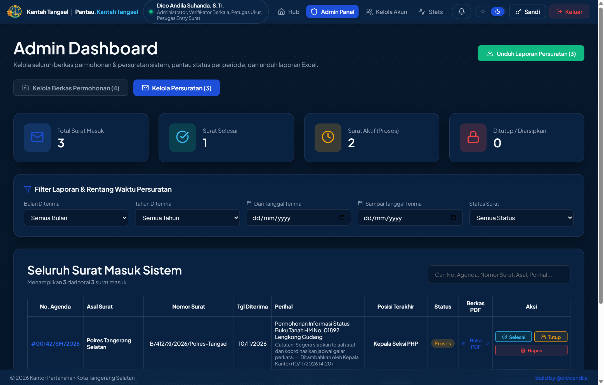

### Fitur Utama Admin Panel (Berkas & Persuratan):
1. **Dua Tab Manajemen Utama**: Beralih dengan mudah antara **`Kelola Berkas Permohonan`** dan **`Kelola Persuratan (Surat Masuk)`** lengkap dengan kartu ringkasan status masing-masing modul.
2. **Filter Multi-Dimensi**:
   - Saring data berdasarkan **Kata Kunci Pencarian**, **Bulan**, **Tahun**, **Rentang Tanggal Mulai–Akhir**, **Jenis Kegiatan**, **Status Berkas/Surat** (*Proses, Selesai, Ditutup*), serta **Status SLA** (*Aman / Lewat SOP*).
3. **Unduh Laporan Excel (`.xlsx`)**:
   - Klik tombol hijau **`Unduh Laporan Excel`** (atau **`Unduh Laporan Persuratan`**) di kanan atas untuk mengekspor seluruh data sesuai filter aktif ke dalam file spreadsheet Microsoft Excel lengkap dengan rincian tanggal masuk, posisi terakhir, status SLA, dan catatan.
4. **Tindakan Administratif pada Berkas/Surat**:
   - **Selesaikan Manual (`✓ Selesai`)**: Menandai berkas/surat telah *Selesai* secara langsung.
   - **Tutup Berkas/Surat (`🔒 Tutup`)**: Menutup berkas/surat yang dibatalkan atau dikembalikan dengan wajib mencantumkan **Alasan Penutupan Resmi** pada jendela konfirmasi.
   - **Hapus Permanen (`🗑️ Hapus`)**: Menghapus data berkas/surat yang salah input beserta seluruh riwayat perjalanannya.
   - **Pintasan Cepat di Navbar**: Di bagian atas terdapat tombol navigasi langsung menuju **`Kelola Akun`** dan **`Stats` (Statistik Pengguna Online)**.

---

## 13. Manajemen Pengguna & Hak Akses Multi-Role (`/admin/users`)

Administrator dapat menambah, mengedit, atau menghapus akun pegawai melalui halaman **Manajemen Pengguna (`/admin/users`)**.

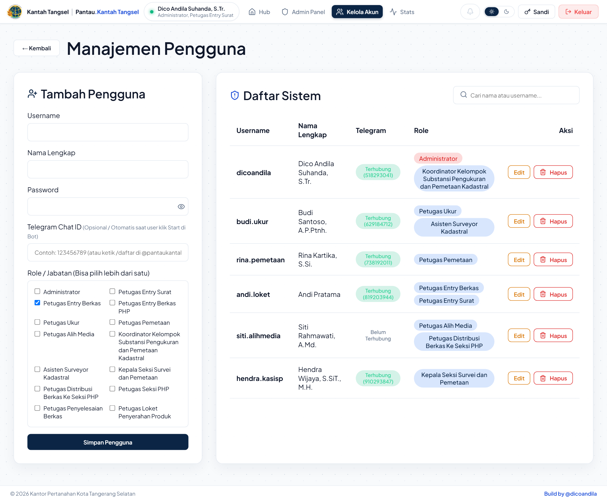

### Cara Mengelola Akun Pegawai:
1. **Tambah Pengguna Baru**:
   - Isi **Username**, **Nama Lengkap & Gelar**, **Password**, serta **Telegram Chat ID** (opsional).
   - **Dukungan Multi-Role (Jabatan Rangkap)**: Centang satu atau beberapa jabatan sekaligus pada daftar **Hak Akses / Role** (misalnya seorang pegawai merangkap sebagai *Petugas Ukur* sekaligus *Asisten Surveyor Kadastral*).
   - Klik **Tambah Pengguna**.
2. **Edit Akun / Reset Password / Perbarui Role**:
   - Klik tombol **Edit** pada baris nama pegawai di tabel sebelah kanan.
   - Formulir di sebelah kiri akan terisi otomatis. Anda dapat memperbarui nama, menambah/mengurangi centang jabatan (*role*), memperbarui *Telegram Chat ID*, atau mengisi kolom password baru jika pegawai lupa kata sandi.
   - Klik **Simpan Perubahan**.

---

## 14. Statistik Pengguna Online & Manajemen Sesi Real-Time (`/admin/stats`)

Halaman **Statistik Web-App (`/admin/stats`)** memungkinkan Administrator memantau aktivitas penggunaan sistem secara langsung (*live monitoring*).

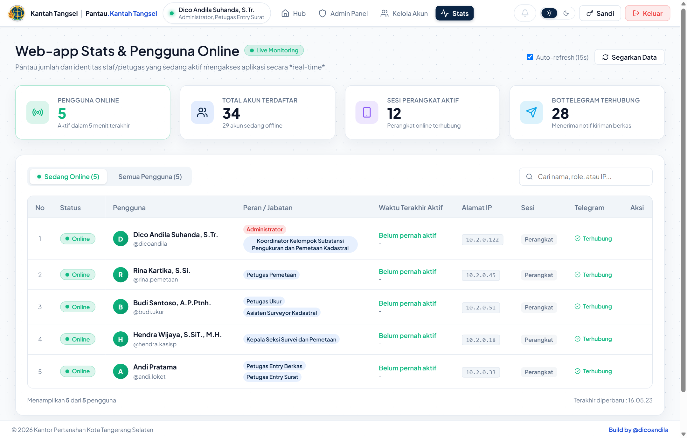

### Fitur Pemantauan Real-Time:
1. **Kartu Indikator Kehadiran**:
   - Menampilkan **Total Pengguna Terdaftar**, **Pengguna Sedang Online** (aktif dalam 2 menit terakhir), **Total Sesi Login Aktif**, dan **Pengguna Terhubung Telegram**.
2. **Pembaruan Otomatis (*Auto-Refresh* 15 Detik)**:
   - Data diperbarui secara otomatis setiap 15 detik tanpa perlu memuat ulang halaman.
3. **Informasi Teknis Perangkat & Jaringan**:
   - Menampilkan waktu terakhir aktif (*Baru saja*, *1 menit lalu*), alamat **IP Jaringan Lokal**, jenis perangkat/browser yang digunakan, serta status koneksi Telegram masing-masing pegawai.
4. **Putuskan Sesi (*Force Logout / Kick Session*)**:
   - Jika terdapat akun pegawai yang tertinggal login di perangkat lain atau membutuhkan penyegaran hak akses segera, Administrator dapat mengklik tombol **Putuskan Sesi** pada baris pegawai tersebut untuk mengeluarkan sesi loginnya dari jarak jauh secara instan.

---

> **Catatan Bantuan Teknis:**  
> Apabila Anda mengalami kendala akses jaringan lokal, pembaruan tampilan pada perangkat seluler (iOS/Android), atau membutuhkan penyesuaian hak akses jabatan (*role*), silakan menghubungi **Administrator Sistem Seksi Survei dan Pemetaan — Kantor Pertanahan Kota Tangerang Selatan**.

